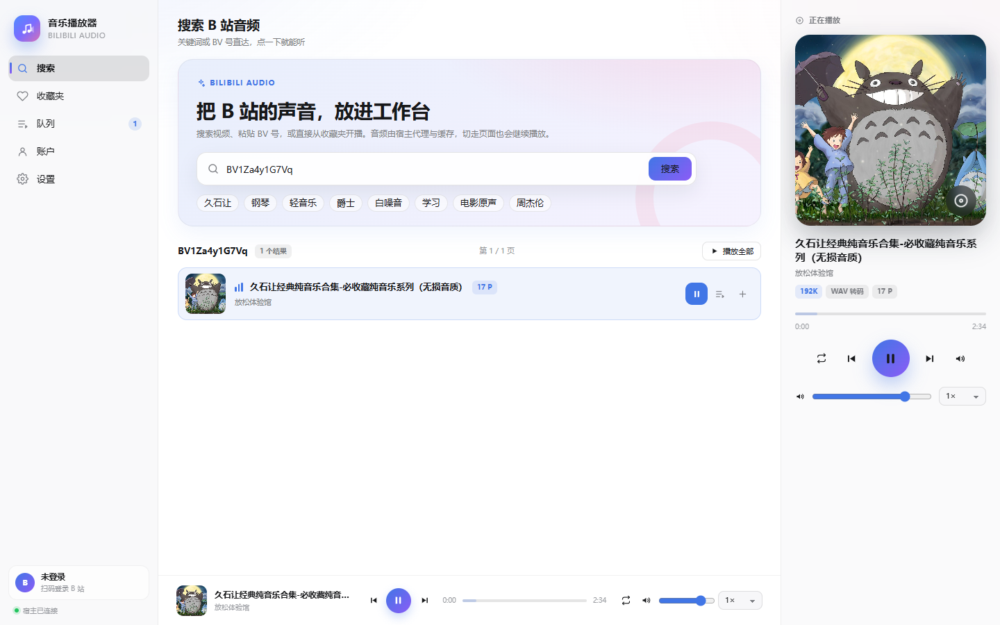

# dsh-music-player

一个 DeepSeek Harness（DSH）Web 插件：在**左侧活动栏**里点开，**右侧整页**就是播放器。搜索并播放 B 站音频，扫码登录后浏览和整理收藏夹；切回会话、折叠侧栏或切换活动页时音乐继续播放。

本插件移植自 [`vscode-music-player`](../vscode-music-player)，功能保持一致，界面按 DSH 的设计语言重做，并适配了 DSH Web 与桌面端（`dsh-app://` 页面 + 本机 HTTP 宿主）两种运行方式。



## 功能

- **搜索与播放**：关键词搜索 B 站视频，或直接粘贴 BV 号；结果列表可播放、加入队列、加入收藏夹。
- **播放器**：播放/暂停、上一首/下一首、进度拖动、音量/静音、0.5×–2× 倍速、播放模式（顺序 / 列表循环 / 单曲循环 / 随机）。
- **队列**：从任意列表接管队列、追加、拖动排序、移除、清空、点播；播放模式与队列会记住。
- **账户**：手机 B 站 App 扫码登录，登录态持久化；退出登录保留设备指纹。
- **收藏夹**：列出收藏夹、打开并分页浏览、夹内搜索、新建/删除收藏夹、多选移出、给视频加入/移出收藏夹、播放整个歌单（剩余页在后台继续补进队列）。
- **音质与缓存**：64K / 132K / 192K；宿主把音频缓存到本机，超过上限按最久未使用淘汰；可在设置里查看占用和清空。
- **状态栏迷你播放条**：DSH 底部状态栏显示当前曲目、进度与播放/下一首按钮，点击曲名回到播放器页。
- **快捷键**：`Ctrl+Alt+Space` 播放/暂停，`Ctrl+Alt+←` 上一首，`Ctrl+Alt+→` 下一首（可在 DSH 快捷键设置里改）。
- **切页不中断**：播放器和 `<audio>` 元素由浏览器插件单例持有，不随活动页卸载；实测切回会话后继续播放。
- **两种音频路径**：
  - 浏览器支持 AAC 时直接代理原始 fMP4/AAC，起播快、支持 Range 拖动；
  - Electron / 不支持 AAC 的环境自动回退到宿主 AAC → WAV 转码，仍然可以播放。
- **桌面端适配**：自动读取 `window.__DSH_TRANSPORT__.streamBaseUrl`，把 API、封面和音频指向本机宿主 HTTP 源，并带 CORS；Web GUI 下保持同源相对路径。

## 安装

插件是标准的 DSH profile bundle。

### 通过 Plugins 页面（推荐）

1. 打开 DSH 左侧活动栏的 **Plugins**。
2. **Add plugin → Install a third-party plugin**，填入本地目录：
   ```
   C:\g-workspace\deepseek-harness\dsh-toolkit\dsh-music-player
   ```
3. 安装完成后启用它。桌面端安装/更新客户端 bundle 后，按 `Ctrl+R` 刷新窗口（或重启应用）以加载新的播放器页面。

### 通过 CLI

```sh
# Web profile
dsh plugin --profile web add C:/g-workspace/deepseek-harness/dsh-toolkit/dsh-music-player

# 桌面端 profile（CLI 管理 desktop profile 前需要完全退出应用）
dsh plugin --profile desktop add C:/g-workspace/deepseek-harness/dsh-toolkit/dsh-music-player
```

卸载：

```sh
dsh plugin --profile web remove dsh-music-player
```

## 使用

1. 点左侧活动栏的音乐图标，打开播放器页。
2. 在搜索框输入关键词，或粘贴 `BV...`；点结果行右侧的播放按钮。
3. 点结果行右侧的 `+` 加入队列，或点 `♡` 选择收藏夹。
4. 在「队列」页拖动排序、切换播放模式；在「收藏夹」页管理收藏夹。
5. 在「账户」页扫码登录；登录后才能使用收藏夹。
6. 切回会话后音乐继续；底部状态栏会显示当前曲目。

## 设置

| 设置 | 默认 | 说明 |
| --- | --- | --- |
| 音质 | `192K` | 64K / 132K / 192K；未登录时 B 站可能返回较低音质 |
| 默认播放模式 | 顺序播放 | 顺序 / 列表循环 / 单曲循环 / 随机 |
| 音量 | `0.8` | 播放器音量滑块的初始值，改变后会写回 |
| 播放速度 | `1×` | 0.5×–2× |
| 启用磁盘缓存 | 开 | 关闭后不再写入新缓存 |
| 缓存上限 | `500 MB` | 超出后按最久未使用淘汰 |
| 请求间隔 | `350 ms` | 对 B 站接口的两次请求之间的最小间隔 |
| 状态栏显示曲目 | 开 | 在 DSH 底部状态栏显示迷你播放条 |
| 日志级别 | 常规 | 关闭 / 常规 / 详细；设置页可查看宿主最近日志 |

设置保存在 `$DSH_HOME/music-player/settings.json`。

## 数据与安全

- 登录 cookie、WBI key、设置和音频缓存都在：
  ```
  $DSH_HOME/music-player/
  ```
  默认 `$DSH_HOME` 为 `%USERPROFILE%\.dsh`。
- 音频缓存分 `cache/raw`（原始 AAC/fMP4）和 `cache/wav`（转码后的 WAV）。
- 登录凭据仅保存在本机，不会上传到其他服务；退出登录只清除登录 cookie，保留设备指纹以降低风控概率。
- 宿主的 `/dsh-music-player` 路由挂在 DSH 自己的 Web 服务上，不额外监听端口；桌面端跨源访问时按请求的 `Origin` 返回 CORS 头。
- 写操作（收藏夹增删等）要求 `application/json` 请求体；媒体 id 是进程内随机 UUID，不提供任意 URL 代理。

## 开发

```bash
npm install
npm run build      # 打包宿主 lib/index.js 与浏览器 lib/client.js
npm run check      # node --check 两个产物
npm test           # 暂无单测入口，见下面的冒烟脚本
```

冒烟/集成脚本：

```bash
node scripts/test-host.mjs     # 在普通 Node HTTP 服务上挂载宿主路由，测试搜索/播放/Range/缓存/设置/二维码
node scripts/test-client.mjs   # jsdom + 假 DSH Slot 宿主，渲染活动页与状态栏
node scripts/test-browser.mjs  # 真实 Chrome（Playwright），跨源模拟桌面端，验证 AAC/WAV 播放与切页不中断
```

`test-browser.mjs` 默认使用系统 Chrome：

```
C:/Program Files/Google/Chrome/Application/chrome.exe
```

可用 `DMP_CHROME` 环境变量覆盖。

### 结构

```
src/host/                宿主半侧（Node）
  index.ts               入口：注册 webServer 路由
  host.ts                /dsh-music-player 路由、设置、账户、静态媒体
  bili.ts                B 站 API、WBI、cookie、错误归一化、收藏夹
  qr.ts                  扫码登录状态机
  media.ts               媒体条目、原始代理、WAV 交付、Range、缓存
  store.ts               设置 / cookie / WBI 的原子 JSON 持久化
  audio/                 移植的 AAC→WAV 流水线（mp4box + wasm 解码器）
src/client/              浏览器半侧（React）
  index.tsx              活动栏图标、活动页、状态栏、快捷键
  player.ts              单例播放控制器（audio、队列、收藏夹、登录、设置）
  api.ts                 同源/跨源 API 客户端
  queue.ts               纯函数队列与播放模式
  styles.ts              按 DSH 主题 token 编写的样式
  ui/                    播放器页面、状态栏、弹窗
lib/                     构建产物（随包发布）
```

宿主产物内置了 `qrcode`、`mp4box` 和 `@wasm-audio-decoders/aac`，安装时不需要额外的运行时依赖。

## 已知限制

- 只支持 AAC（`mp4a`）音轨；Dolby / Hi-Res 等需要额外 wasm 解码器。
- WAV 回退路径单曲上限 30 分钟；更长的高清合集请使用支持 AAC 的浏览器。
- 多 P 视频默认播放 P1；暂未提供 P 选择器。
- B 站搜索/接口可能触发风控；稍后再试或登录后可降低概率。
- 桌面端安装或更新后需要刷新窗口以加载新的客户端 bundle。
- 插件依赖 B 站网页/客户端接口，接口变更可能导致搜索或播放失败；设置页的宿主日志可用于排查。

## 许可

MIT。

音频解封装使用 [`mp4box`](https://github.com/gpac/mp4box.js)（BSD-3-Clause），AAC 解码使用 [`@wasm-audio-decoders/aac`](https://github.com/eshaz/wasm-audio-decoders)（MIT，libfaad2 的 wasm 构建），二维码生成使用 [`qrcode`](https://github.com/soldair/node-qrcode)（MIT）。功能与交互参考 [`vscode-music-player`](../vscode-music-player)。
