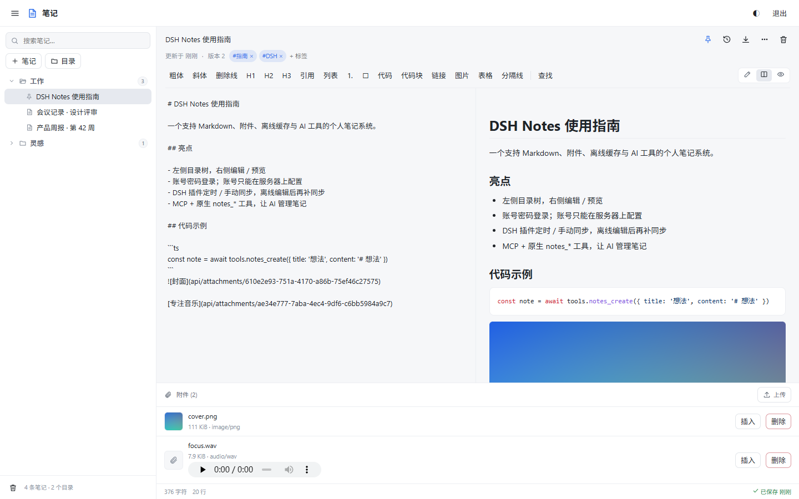
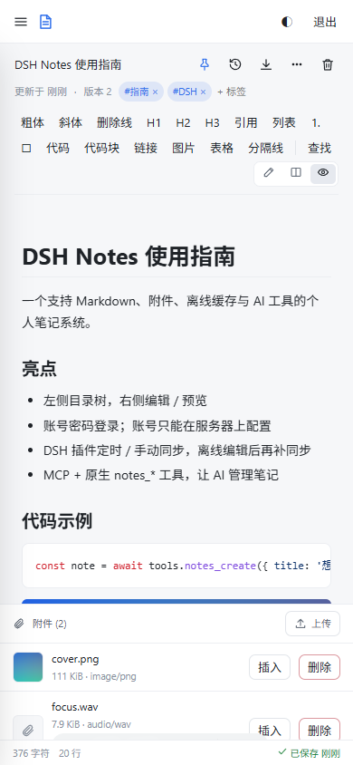
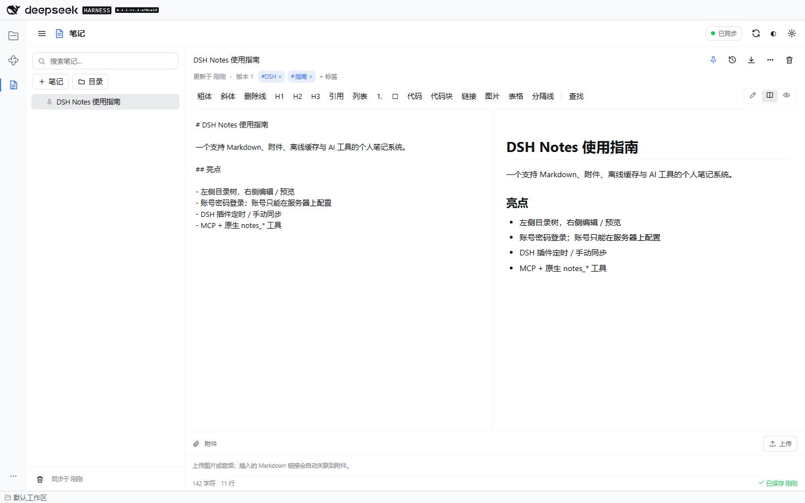

# DSH Notes

DSH Notes 是一个**独立笔记服务端 + DSH 插件**：浏览器用账号密码登录，DSH 页面用可撤销访问令牌连接；笔记支持 Markdown、图片/音频附件、实时自动保存、离线缓存、定时/手动同步，并提供原生 `notes_*` AI 工具与标准 MCP 端点。



手机浏览器：



DSH 插件页面：



## 功能

- **账号密码登录**：账号只能通过服务器本机 CLI 创建、改密、禁用、删除；网页/API **没有注册、找回密码、改密、用户或令牌管理入口**。
- **Markdown 编辑与预览**：GFM 表格、任务列表、代码高亮、图片/音频附件、查找替换、常用格式工具栏。
- **实时保存**：网页输入停止 800ms 自动保存；SSE 让其他标签页同步刷新。
- **目录树**：文件夹/笔记创建、重命名、移动、删除、回收站、历史版本、置顶、标签、全文搜索。
- **DSH 插件**：左侧活动栏入口；本地 SQLite 缓存；离线可读可改；按间隔自动同步、手动同步；冲突 diff 与三种解决方式。
- **AI / MCP**：DSH 内置 25 个原生 `notes_*` 工具；服务端提供标准 MCP Streamable HTTP `/mcp`（工具、资源、提示词）。
- **安全**：scrypt 密码哈希、可撤销 Bearer 令牌、会话 Cookie、CSRF/Origin 校验、登录限速、上传白名单与 magic bytes、路径遍历防护、CSP/安全头、默认只监听回环、单业务端口。
- **跨平台**：同一份纯 JS 服务端产物可运行在 Windows、Linux、Debian；无原生模块、无需 Visual Studio/Python 构建工具；提供 systemd、Caddy、Nginx、Docker Compose、Windows 计划任务/NSSM 方案。

## 架构

```text
浏览器（任意设备） ──账号密码登录──┐
                                  ▼
                         ┌──────────────────────────┐
                         │ 笔记服务端（Node 24）      │
                         │ SQLite + attachments/     │
                         │ HTTP API + SSE + Web SPA  │
                         │ MCP /mcp（Bearer）        │
                         └──────────▲───────────────┘
                                    │ HTTPS
                         ┌──────────┴───────────────┐
                         │ DSH host 插件             │
                         │ 本地缓存 / 同步 / AI 工具 │
                         │ 不监听新端口              │
                         ├──────────────────────────┤
                         │ DSH client 插件           │
                         │ 活动栏 + 笔记页面         │
                         └──────────────────────────┘
```

- 服务端只开一个业务端口；DSH 插件只把同源路由挂到 DSH 现有 Web 服务上。
- 浏览器登录用账号密码；DSH 插件/MCP 用服务器 CLI 签发的访问令牌。插件不保存密码。
- 附件保存在 Web 根目录之外，只通过鉴权路由读取，永远不会被当作代码执行。

## 快速开始（服务端）

要求 **Node.js 24+**（内置 `node:sqlite`）。二选一：

```bash
# A. 从仓库/压缩包解压后，在解压目录里直接运行
node server/bin.js version

# B. 全局安装打包好的 tgz
npm install -g ./dist/dsh-notes-0.1.0.tgz
dsh-notes-server version
```

两种安装方式的命令不同：

| 场景 | 命令 |
|---|---|
| 在解压目录/仓库里 | `node server/bin.js <子命令>` |
| `npm install -g` 之后 | `dsh-notes-server <子命令>` |
| 任意目录调用全局包里的原文件 | `node "$(npm root -g)/dsh-notes/server/bin.js" <子命令>` |

> `node server/bin.js` 使用的是**当前目录下的相对路径**；全局安装后当前目录没有 `server/`，所以会报“找不到模块”。这时请直接用 `dsh-notes-server`，或通过 `npm root -g` 拼出绝对路径。

创建数据目录、账号与插件令牌（只能在服务器本机执行）。下面以解压目录/仓库为例；如果是全局安装，把 `node server/bin.js` 全部替换为 `dsh-notes-server`：

```bash
# 解压目录/仓库：
node server/bin.js init --data-dir /var/lib/dsh-notes
node server/bin.js user add alice --data-dir /var/lib/dsh-notes
# 按提示输入两次密码（不回显，至少 12 位）
node server/bin.js token create --user alice --name dsh-plugin --data-dir /var/lib/dsh-notes
# 令牌只显示一次，请立即保存

# 全局安装：
# dsh-notes-server init --data-dir /var/lib/dsh-notes
# dsh-notes-server user add alice --data-dir /var/lib/dsh-notes
# dsh-notes-server token create --user alice --name dsh-plugin --data-dir /var/lib/dsh-notes
```

启动（默认只监听 `127.0.0.1:8787`）：

```bash
# 解压目录/仓库：
node server/bin.js serve --data-dir /var/lib/dsh-notes \
  --host 127.0.0.1 --port 8787 \
  --public-url https://notes.example.com --behind-proxy

# 全局安装：
# dsh-notes-server serve --data-dir /var/lib/dsh-notes \
#   --host 127.0.0.1 --port 8787 \
#   --public-url https://notes.example.com --behind-proxy
```

打开 `https://notes.example.com`（或本机 `http://127.0.0.1:8787`）用账号密码登录。公网部署必须通过 Caddy/Nginx 终止 TLS，**不要**把 8787 直接暴露到公网。反向代理与 systemd/Docker 示例见 [部署文档](docs/deployment/)。

Windows 数据目录示例：`C:\ProgramData\dsh-notes`。macOS 未列入验收范围。

## 安装 DSH 插件

目标 DSH：**0.2.1-rc.2**。安装/升级请使用该版本自带的 CLI，而不是 PATH 上可能较旧的全局 `dsh`：

```powershell
# Windows 桌面版自带的 0.2.1-rc.2 CLI
& "C:\Users\<你>\AppData\Local\Programs\DeepSeek Harness\resources\runtime\cli\bin\dsh.cmd" `
  plugin --profile desktop add "C:\g-workspace\deepseek-harness\dsh-toolkit\dsh-notes"
```

Linux/macOS（DSH 安装目录中的 CLI）：

```bash
dsh plugin --profile desktop add /opt/dsh-toolkit/dsh-notes
```

重启 DSH 后，左侧活动栏出现「笔记」入口。首次打开：

1. 在服务器上执行 `token create`（见上）。
2. 在插件「设置」里填服务器地址（如 `https://notes.example.com`）和访问令牌。
3. 点「测试连接」→「保存」。插件会立即全量同步。

插件不接收账号密码；账号密码只用于网页登录。插件不会打开新端口。

开发期可以不改真实 profile，用绝对路径 `--patch` 加载（`name` 指向构建后的 `lib/index.js`）：

```yaml
# dsh-notes/tmp/dev.patch.yml
- insert:
    - id: dsh-notes
      name: 'C:/g-workspace/deepseek-harness/dsh-toolkit/dsh-notes/lib/index.js'
```

```bash
dsh web --patch ./dsh-notes/tmp/dev.patch.yml --no-open --port 18888
```

`DSH_HOME` 指向临时目录时，插件会在该目录的 `notes/settings.json` 读取服务器 URL 与令牌；`npm run test:dsh` 会自动完成这套隔离联调。

## AI / MCP

### DSH 原生工具（推荐）

插件加载后自动注册 25 个 `notes_*` 工具，无需额外配置。示例：

- `notes_search` / `notes_get` / `notes_create` / `notes_update` / `notes_append`
- `notes_tree` / `notes_recent` / `notes_stats` / `notes_sync`
- `notes_folders_create` / `notes_folders_update` / `notes_folders_delete`
- `attachments_list` / `attachments_add` / `attachments_delete`
- `notes_history` / `notes_restore_version` / `notes_daily`

### MCP 端点

服务端在同一个端口提供 `https://notes.example.com/mcp`。所有请求需要 Bearer 令牌；可以给 AI 单独签一个令牌，方便审计和撤销。

```yaml
# DSH mcp-client 配置示例（放在 workspace 的 .dsh/mcp.yml 或全局 MCP 配置）
- id: mcp-notes
  name: '@deepseek-ai/dsh-mcp-client'
  config:
    serverName: notes
    transport: streamable-http
    url: https://notes.example.com/mcp
    headers:
      Authorization: !!js '`Bearer ${process.env.DSH_NOTES_TOKEN}`'
```

MCP 工具、资源（`notes://tree`、`notes://note/{id}`、`notes://recent`）和提示词（`notes.summarize`、`notes.organize`）见 [MCP 文档](docs/mcp.md)。

## 安全要点

- 账号、密码、令牌都只能在**服务器本机 CLI** 管理；没有注册/找密/网页改密接口。
- 默认只监听回环；公网必须使用 TLS 反代或显式 `--tls-cert/--tls-key`；非回环明文监听会被拒绝。
- 只开一个业务端口；不暴露数据库/管理/调试端口；支持 Unix Socket。
- 附件只允许图片/音频，扩展名 + magic bytes 双检；存储于 Web 根目录之外；永不作为 HTML/JS 提供。
- 服务端没有 shell/`child_process`/动态插件加载/任意 URL 拉取。唯一例外是 MCP SDK 内 Ajv 为**静态工具 schema** 编译校验函数（`new Function`），客户端不能提交 schema；详见 [安全文档](docs/security.md)。
- 登录限速、账号锁定、scrypt 哈希、会话轮换/过期、令牌撤销/只读 scope、CSRF + Origin 校验、路径遍历与大小限制，均有自动化测试。
- 反向代理、systemd、Docker、Windows ACL 加固示例见 [部署文档](docs/deployment/)。

更完整的威胁模型与检查清单：[docs/security.md](docs/security.md)。

## 平台部署

- [Windows](docs/deployment/windows.md)
- [Linux](docs/deployment/linux.md)
- [Debian](docs/deployment/debian.md)
- [Docker（Linux/Debian 主机）](docs/deployment/docker.md)

## 开发与测试

```bash
npm install --ignore-scripts   # 仅开发依赖；运行时不依赖 node_modules
npm run build                  # server/lib + lib + web
npm run check                  # 产物、清单、危险 API、平台检查
npm test                       # server/security/MCP/host/client
npm run smoke                  # 跨平台启动/登录/附件/重启冒烟
npm run test:e2e               # 真实 Chrome：登录、编辑、附件、SSE、移动端
npm run test:dsh               # 隔离 DSH_HOME + --patch 的真实 DSH 联调
npm run screenshot             # 生成 docs/ 截图
npm run package:dist           # 生成 dist/*.tgz + *.zip + SHA256SUMS
```

Windows 上 `npm install` 如遇生命周期脚本被环境阻止，可使用 `npm install --ignore-scripts`；本项目运行时不需要任何 npm 依赖。

## 目录

```text
dsh-notes/
├── src/server/       HTTP、SQLite、账号/令牌、附件、MCP、CLI
├── src/host/         DSH host：本地缓存、同步、路由、AI 工具
├── src/client/       DSH client：活动栏 + 页面
├── src/web/          独立 Web SPA
├── src/shared/       类型、编辑器命令、Markdown 渲染、共享 UI
├── server/           bin + 自包含 bundle
├── lib/              DSH host/client bundle
├── web/              构建后的 Web SPA
├── deploy/           systemd/Caddy/Nginx/Docker/Windows
└── docs/             架构、安全、API、MCP、部署
```

## 已知限制

- v1 单用户/每账号独立笔记空间，不共享、不协作；需要共用时只创建一个账号。
- 没有 Web 注册、邀请、找回密码、网页改密、网页用户/令牌管理；这是安全设计。
- 不提供 OAuth/SSO/短信/邮件；可选 TOTP 为后续加固项。
- 不做 WYSIWYG、数学公式、Mermaid、CRDT 实时协同。
- 附件上传需要在线；正文和附件元数据可离线读取。
- 没有 `.deb`、Windows MSI 或原生 Windows Service 封装；使用 tarball/zip + systemd/Task Scheduler/NSSM/WinSW。
- DSH 目标版本 0.2.1-rc.2；升级 DSH 后请重新跑 `npm run test:dsh`。
