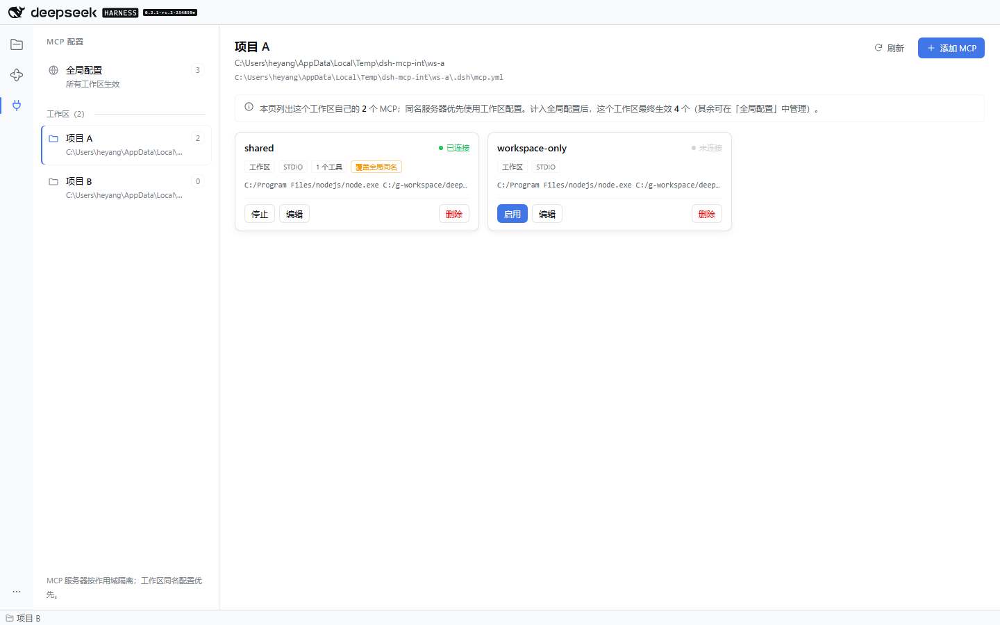

# dsh-scoped-mcp

一个 DeepSeek Harness（DSH）插件：**按工作区隔离的 MCP 配置管理器**。

左侧活动栏新增 **MCP 配置** 入口，点开后是一个两栏页面：左边是「全局配置」加上所有当前已打开的工作区，右边以卡片瀑布流展示所选范围的 MCP 服务器。每张卡片显示名称、当前连接状态、传输方式与目标，并提供 **启用 / 停止**、**编辑**、**删除**。启用或停止的结果会以页面右下角的通知提示。

同名 MCP 服务器**优先使用工作区范围的配置**：工作区的同名条目会整体替换全局条目，其他全局条目仍然对该工作区生效。



## 作用域与配置文件

| 作用域 | 文件 | 说明 |
|---|---|---|
| 全局 | `<DSH_HOME>/mcp-scope.yml`（默认 `~/.dsh/mcp-scope.yml`） | 对所有工作区生效 |
| 工作区 | `<工作区>/.dsh/mcp.yml` | 只对该工作区的会话生效；同名条目覆盖全局 |

合并规则（`loadMergedServers`）：

1. 先放入全部全局条目；
2. 再用工作区条目覆盖同名项；
3. 结果按名称排序，并标注来源 `scope`。

## 安装

```bash
dsh plugin --profile desktop add C:/g-workspace/deepseek-harness/dsh-toolkit/dsh-scoped-mcp
```

或使用应用里的 **Plugins** 页面选择本目录安装。安装后需要重启 profile（桌面端即重启应用）才会加载新的宿主插件与浏览器半侧。

卸载：

```bash
dsh plugin --profile desktop remove dsh-scoped-mcp
```

## 页面使用

- **全局配置**：固定在工作区列表顶部，展示全局文件里的配置。
- **工作区**：点击任意工作区，右侧展示**该工作区自己文件里的**配置（全局条目仍参与运行，但归「全局配置」页管理）。页面顶部会说明「计入全局后最终生效多少个」，卡片上的「覆盖全局同名」标记表示该条目替换了一个同名全局条目；这里的「启用 / 停止」只影响该工作区的同名连接，不会动全局条目。
- **添加 MCP**：在右侧工具栏添加，表单写到当前选中的范围（全局页写全局文件，工作区页写该工作区的 `.dsh/mcp.yml`）。支持 STDIO 与 HTTP 两种传输。
- **启用 / 停止**：
  - 「启用」立即连接该 MCP 服务器；成功时通知发现多少个工具，失败时通知具体错误，卡片同时保留错误文本。
  - 「停止」立即断开该连接，并从所有正在使用它的会话里移除对应工具。停止只作用于当前 Host 进程：在重新启用或重启 Host 之前，即使新建会话也不会再次自动连接。
  - 若配置里写了 `disabled: true`，卡片显示「已停用」；点「启用」会清除该标记并连接。
- **编辑**：保存后写入配置文件；如果该服务器原本已连接，会先断开再按新配置重新同步，避免旧连接继续按旧配置工作。
- **删除**：从配置文件移除并断开连接，需要二次确认。

页面可见时每 2 秒轮询一次状态，因此连接断开、被其他方式修改的配置文件、或者由会话自动建立的连接都会自动反映到卡片上。

## 运行时行为

会话（Agent）创建时：

1. 用 `session.header.cwd` 解析所属工作区：优先匹配已注册工作区（最长前缀），否则回退到最近的项目根（含 `.git` 的目录），再回退到 cwd 本身；
2. 读取并合并该工作区的全局 + 工作区配置；
3. 对每个未停用、未被用户停止的条目建立连接（同一「作用域 + 名称」只有一条连接，被该作用域内所有会话共享）；
4. 连接成功后，把该服务器的工具以 `mcp__<serverName>__<toolName>` 注册到**每个订阅会话自己的** `agent.ctx.tools`，所以不同工作区的会话看到的 MCP 工具不同；
5. 会话销毁时取消订阅；当最后一个订阅者离开且用户没有手动启用时，连接关闭。

在页面里新增/启用/删除配置后，正在运行的会话会立即重新同步，无需新建会话。连接和 `tools/list` 是异步的：新建会话后立刻发送第一条消息时，工具可能还没出现；连接完成后会自动注册，等同于官方 `mcp-client` 的行为。

## 配置格式

```yaml
servers:
  - serverName: github
    transport: stdio
    command: npx
    args: ["-y", "@modelcontextprotocol/server-github"]
    env:
      GITHUB_TOKEN: xxx
    disabled: false

  - serverName: internal-api
    transport: streamable-http
    url: http://localhost:3000/mcp
    headers:
      Authorization: Bearer xxx
```

| 字段 | 必填 | 说明 |
|---|---|---|
| `serverName` | 是 | `[A-Za-z0-9_-]{1,32}`，在同一范围唯一；也是模型可见工具名的命名空间 |
| `transport` | 是 | `stdio` 或 `streamable-http` |
| `command` | stdio | 可执行文件 |
| `args` | 否 | 命令参数数组 |
| `env` | 否 | 追加到宿主进程环境之上的环境变量 |
| `cwd` | 否 | 子进程工作目录 |
| `url` | http | MCP 端点 |
| `headers` | 否 | 附加到 HTTP 请求的请求头 |
| `toolCallTimeoutMs` | 否 | 单次工具调用超时，默认 `60000` |
| `disabled` | 否 | 持久停用；页面上的「启用」会清除它 |
| `failOnStartupError` | 否 | 兼容字段：当前版本连接失败总是只记为错误状态，不阻止 Host 启动 |
| `reconnect.*` | 否 | 兼容字段：当前版本不自动重连，连接中断后卡片显示「连接失败」，点「启用」重试 |

配置文件由本插件写入时会带一行注释头，并采用「临时文件 + rename」的原子写法。

## CLI

宿主插件与 CLI 共用同一套配置文件与校验：

```bash
dsh-scoped-mcp list [--scope global|PATH] [--json]
dsh-scoped-mcp add --scope global|PATH --name <serverName> --stdio --command <cmd> [--args ...] [--env K=V ...]
dsh-scoped-mcp add --scope global|PATH --name <serverName> --http --url <url> [--header K=V ...]
dsh-scoped-mcp remove --scope global|PATH --name <serverName> [--yes]
dsh-scoped-mcp enable|disable --scope global|PATH --name <serverName>
dsh-scoped-mcp test --scope global|PATH --name <serverName>
```

CLI 的 `disable` 写 `disabled: true`；`enable` 清除它。CLI 修改不会自动同步到正在运行的 Host，页面轮询会显示新配置，但连接需要点一次「启用」或等新会话建立。

## 安全与边界

- 页面的 API（`/dsh-scoped-mcp/state`、`/dsh-scoped-mcp/action`）挂在 DSH 自己的 Web 服务上，没有额外端口，也不经过 CORS；每个请求先经过宿主 `connection` 服务的 Host/Origin 与登录令牌校验，只有已认证的界面能读写配置或启动进程。
- STDIO 子进程继承 DSH 宿主进程的环境变量，再叠加 `env` 里的键值；HTTP 请求头同样来自配置。配置文件里不要放你不想被本机其他进程读到的密钥。
- 本插件只桥接 MCP **工具**（`tools/list` / `tools/call`）。MCP 资源、提示模板、任务式执行、elicitation 不在此实现范围内。
- 全局连接在所有未覆盖它的工作区之间共享；同一个 MCP 服务器看到的是同一个客户端会话。
- 连接状态保存在 Host 进程内存中，重启后全部回到「未连接」；配置本身持久化在 YAML 文件里。

## 开发

```bash
cd dsh-toolkit/dsh-scoped-mcp
npm run check   # 全部源文件的语法检查
npm test        # 宿主半侧 + 浏览器半侧测试
```

测试说明：

- 宿主测试用真实的 `McpConnection` 对内存 MCP 服务器（SDK `InMemoryTransport`）以及 `scripts/fake-mcp-server.mjs` 子进程验证连接、工具发现与调用，并用进程内假连接覆盖作用域优先级、会话工具注册、启用/停止、保存/删除与卸载。
- 路由测试用假的 `webServer` / `connection` 覆盖状态读取、动作分发、Content-Type 校验与信任闸门。
- 浏览器测试在 JSDOM 中加载真实的 `lib/client.js` 打包产物，通过假的 `window.__ModuleLoader__` 与假槽位注册渲染页面，并驱动启用/停止操作。
- `scripts/screenshot.mjs` 可以用无头 Chrome 打开一个运行中的 DSH Web 实例，点击活动栏的 MCP 入口并截图（`--workspace` 可选中某个工作区），README 的截图就是这样生成的：

```bash
node scripts/screenshot.mjs --url "http://127.0.0.1:3080/?token=..." --workspace "项目 A"
```
