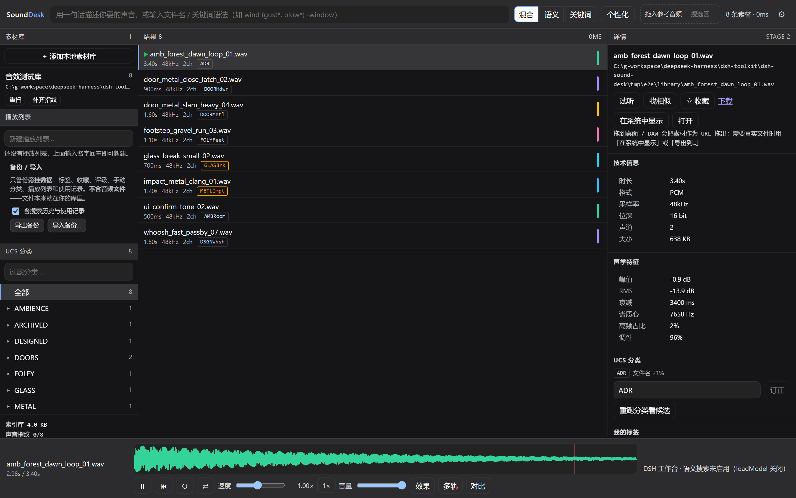

# dsh-sound-desk

DeepSeek Harness（DSH）插件：把 **SoundDesk 音效素材工作台**搬到 DSH 里。点左侧活动栏的波形图标，右侧整页就是工作台 —— 索引本地音效库、中英文语义搜索、UCS 自动分类、波形试听、内嵌元数据写回、效果链与多轨渲染。

本插件移植自 [`sound-desk`](../sound-desk) 的 VS Code 扩展（`apps/vscode-extension`），**功能保持一致**；界面按 DSH 的设计语言重做（`--dsw-alias-*` 主题令牌 + 阴影 DOM 隔离），并适配 DSH Web 与桌面端两种运行方式。



## 与原扩展的功能对照

| VS Code 扩展 | 本插件 |
| --- | --- |
| 活动栏 + 素材库侧边栏树 | 活动栏图标 → 整页工作台；素材库/播放列表/UCS 分类在页面左栏 |
| `soundDesk.open` 打开工作台 | 点活动栏图标，或 `Ctrl+Alt+S` |
| `soundDesk.indexFolder` 添加素材库 | 「＋ 添加本地素材库」对话框：系统目录选择器 + 可直接粘贴路径 |
| `soundDesk.refreshLibrary` | 侧栏每个库的「重扫 / 补齐指纹」，设置里的「刷新」 |
| `soundDesk.restartEngine` | 设置 → 「重启引擎」 |
| `soundDesk.showEngineInfo` | 设置里的引擎状态标签与日志面板 |
| `soundDesk.playFile` 试听 | 双击结果行；底部传输条播放/暂停、循环、倒放、变速、音量 |
| `soundDesk.findSimilar` | 详情面板 →「找相似」（以声搜声） |
| `soundDesk.addToPlaylist` | 详情/结果行加入播放列表，左侧管理播放列表 |
| `soundDesk.setReferenceAudio` | 顶栏「拖入参考音频」/ 波形选区 →「搜选区」 |
| `soundDesk.openPlaylist` | 左侧播放列表直接展开 |
| `soundDesk.copyAssetPath` | 详情面板显示完整路径，可复制 |
| `soundDesk.revealAsset` | 详情 →「在系统中显示」 |
| 音频自定义编辑器（`soundDesk.audio`） | DSH 没有编辑器页签，改为工作台内试听 + 「打开」交给系统默认应用 |
| 资源管理器右键菜单 | DSH 无对应表面；同样的动作都在工作台内 |
| 命令面板 13 个命令 | 页面内按钮；唯一保留的快捷键是「打开工作台」 |

功能本身没有删减：扫描入库、WAV/BWF 元数据（bext / iXML / LIST-INFO）读写回、DSP 声学特征、UCS 843 类分类与证据链、FTS5 + 向量 + UCS + 重排、以声搜声（含长文件切窗 max-sim）、播放列表、库级旁挂备份/导入、效果链（EQ / 失真 / 混响 / 距离 / ADSR）、多轨叠层与混音/分轨导出、多栏对比、个性化排序、拖出到 DAW。

## 安装

插件是标准的 DSH profile bundle。

### 通过 Plugins 页面（推荐）

1. 打开 DSH 左侧活动栏的 **Plugins**。
2. **Add plugin → Install a third-party plugin**，填入本地目录：
   ```
   C:\g-workspace\deepseek-harness\dsh-toolkit\dsh-sound-desk
   ```
3. 安装后启用它，重启 DSH（宿主半侧需要重新加载；客户端 bundle 在下次打开页面时生效）。

### 通过 CLI

```sh
# 桌面端 profile（CLI 管理 desktop profile 前需要完全退出应用）
dsh plugin --profile desktop add C:/g-workspace/deepseek-harness/dsh-toolkit/dsh-sound-desk

# Web profile
dsh plugin --profile web add C:/g-workspace/deepseek-harness/dsh-toolkit/dsh-sound-desk
```

卸载：

```sh
dsh plugin --profile desktop remove dsh-sound-desk
```

## 使用

1. 点左侧活动栏的波形图标（或 `Ctrl+Alt+S`）打开「音效工作台」。
2. 第一次使用点「＋ 添加本地素材库」，选一个目录或粘贴路径。导入会依次跑完 **扫描元数据 → 生成波形 → 计算声音指纹**，期间显示全屏进度。
3. 顶栏输入自然语言（例如「金属门重重关上」）或文件名/关键词语法（`wind (gust*, blow*) -window`）。
4. 双击结果行试听；波形上拖动选框可「搜选区」，把外部音频拖到「拖入参考音频」可以以声搜声。
5. 详情面板可以收藏、评级、改 UCS 分类（人工修正后自动分类不再覆盖）、编辑并**写回** WAV/BWF 内嵌元数据、导出效果版。
6. 底部「效果 / 多轨 / 对比」是弹出面板，同一时刻只开一个；关闭效果面板等于旁通整条效果链，参数会保留。

快捷键：`Space` 播放/暂停（焦点在页面内），`Esc` 清除选区。全局 `Ctrl+Alt+S` 打开工作台。

## 设置

顶栏右侧的 ⚙ 打开设置（保存在 `$DSH_HOME/sound-desk/settings.json`）：

| 设置 | 默认 | 说明 |
| --- | --- | --- |
| 数据目录 | 空（`$DSH_HOME/sound-desk`） | 索引库、波形缓存、模型与备份的位置 |
| 加载声音指纹模型（CLAP） | 关 | 语义搜索与以声搜声的前提；首次需下载数百 MB，改完需重启引擎 |
| 随 DSH 启动 | 开 | 关闭后引擎在第一次打开工作台时才启动 |
| ffmpeg 路径 | 空（自动） | 没有 ffmpeg 时只有 WAV/BWF 能生成波形与播放 |
| 可选依赖目录 | 空 | 到哪找 `@huggingface/transformers` 与 `ffmpeg-static`，默认还会查插件自身与 `../sound-desk` |
| 日志级别 | 常规 | 关闭 / 常规（警告与错误）/ 详细；设置里可看最近日志 |

> 数据目录、模型、ffmpeg、依赖目录这些只影响引擎启动的项，保存后需要点「重启引擎」才生效；其余项即时生效。改数据目录不会迁移已有索引。

## 数据与安全

- 索引库、设置、模型、备份都在：
  ```
  $DSH_HOME/sound-desk/        # 默认 C:\Users\<you>\.dsh\sound-desk
    catalog.db                 # SQLite（node:sqlite，含 FTS5）
    settings.json
    models/                    # CLAP 权重缓存
    backups/                   # 写回原文件前的备份
  ```
- 引擎在 **DSH 宿主进程内**运行，只监听 `127.0.0.1` 的随机端口，并持有每次启动新生成的 32 字节令牌；插件把它挂到 DSH 自己的 Web 服务 `/dsh-sound-desk` 下并注入令牌，因此页面同源、无 CORS、页面从不接触令牌。
- 该前缀上的所有路由都走 DSH 的 `connection.requestRejection`（与 DSH 自己的插件路由同一套 Host/Origin 围栏与浏览器凭据）。
- 素材只能按 **assetId** 寻址；「在系统中显示 / 打开」的路径从索引库里查，页面不能传路径。
- 写回内嵌元数据只接受 WAV/BWF；其他格式会改音频本身，因此被拒绝，并提示改用旁挂标签。

## 能力与限制

- **语义搜索需要模型**：默认关闭。没有模型时关键词 + UCS 分类仍然完整可用，界面会明说「语义搜索未启用」，而不是假装搜过。启用后会按「插件自身 `node_modules` → `../sound-desk` → 设置里的参考目录」查找 `@huggingface/transformers`，并使用它自己的 ESM 入口（`transformers.node.mjs`）；加载失败时设置页与日志会给出具体原因，而不是只说「加载失败」。
- **非 WAV 格式需要 ffmpeg**：FLAC/MP3/AIFF/M4A 能入库，但没有 ffmpeg 就没有波形、指纹和试听。插件会先找设置的路径，再找 `SOUNDDESK_FFMPEG`、PATH 与 `ffmpeg-static`。
- **写回只支持 WAV/BWF**：与上游一致，并且默认先备份。
- **拖出**：拖拽带的是可下载 URL（`text/uri-list` / `DownloadURL`），浏览器不能把真实文件交给文件管理器；需要真实文件时用「下载」或「在系统中显示」。DSH 桌面端同样适用。
- **打开**：DSH 没有 VS Code 那样的编辑器页签，「打开」调用系统默认应用。
- **运行环境**：引擎用 `node:sqlite`，需要 Node **23.4+**（DSH 桌面端 Electron 44 内置 Node 24，没问题）。Web 端若跑在 Node 22 上会给出明确提示。

## 架构

```
DSH 客户端（浏览器页）
  ├─ 活动栏图标 / 工作台整页 / Ctrl+Alt+S
  │     Shadow DOM + --dsw-alias-* 主题令牌
  └─ fetch → /dsh-sound-desk/*
                │  同源、凭据由 DSH 负责
                ▼
DSH 宿主（插件 host 半侧）
  ├─ ctx.webServer.register('/dsh-sound-desk')    路由 + 鉴权
  ├─ 代理 → 127.0.0.1:<随机端口>（注入引擎令牌、剥离 Origin）
  └─ @sounddesk/engine（进程内）SQLite / 索引 / 检索 / 波形 / 导出
```

几个有意为之的决定：

- **引擎进程内运行**，与 VS Code 扩展一致：没有子进程要回收，也不用解析 stdout 找端口。
- **同源代理**而不是第二个端口：`<audio>`、波形、Range seek 全都不需要 CORS 或令牌握手，桌面端 `dsh-app://` 页面也照常工作。
- **事件用轮询**：引擎自带的 WebSocket 不再代理，任务进度每 900 ms 轮询一次，比一次扫描步进更快，也少一条会断的传输。
- **阴影 DOM**：工作台的样式表有 `.pane`、`.section`、`.badge` 这类通用类名，前缀命名挡不住泄漏；阴影根让样式与 DSH 外壳互不影响，同时自定义属性（主题令牌）照常穿透。
- **可选重依赖不打包**：`@huggingface/transformers` 与 `ffmpeg-static` 运行时按需查找；没有就明确降级，而不是让插件装不上。

## 开发

```bash
npm install                 # 需要 rolldown / typescript / jsdom / playwright-core
npm run build               # 生成 lib/index.js（宿主）、lib/client.js（浏览器）与 data/（UCS 数据集）
npm run typecheck
npm test                    # 宿主集成测试 + jsdom 客户端冒烟测试
npm run test:e2e            # 真实引擎 + 真实浏览器 bundle 的端到端测试
npm run screenshot          # 用本机 Chrome 渲染离线演示图（打桩数据）
node scripts/test-e2e.mjs --screenshot docs/screenshot.png   # 真实数据出图
```

测试说明：

- `npm run test:host` 用 `apply(ctx)` 装载真实产物，在普通 HTTP 服务上跑通：鉴权、引擎冷启动、UCS 数据集、导入一个真实 WAV、关键词搜索、Range 流、波形、下载、设置与日志；并断言可选依赖解析到了正确的包根目录与 ESM 入口。
- `npm run test:client` 在 jsdom 里用假的 DSH slot 宿主加载 `lib/client.js`，挂载活动页、打开设置与导入对话框。
- `npm run test:model` 用 `loadModel: true` 启动真实产物，断言 `@huggingface/transformers` 从包根目录加载、没有模块加载错误（模型主机指向本地 404，不联网、不下载）。
- `npm run test:e2e` 在真实 Chrome 里跑完整链路：宿主半侧 + 引擎 + 8 个生成的真实 WAV + 真实 `lib/client.js`，验证浏览、选中、播放、波形、设置对话框，并可 `--screenshot` 出图（README 的图就是这么来的）。
- `npm run screenshot` 是离线版：`scripts/harness` 把同一份浏览器半侧跑在 Chrome 里，宿主 API 打桩，用于没有引擎/素材时调 UI。

### 结构

```
src/host/
  index.ts       插件入口：注册 webServer 路由
  host.ts        /dsh-sound-desk 路由、/host/* 动作、鉴权
  engine.ts      引擎生命周期、可选依赖预加载、完整导入
  deps.ts        可选依赖解析：包根目录 + exports 的 ESM 入口
  proxy.ts       同源 → 环回端口的流式代理
  settings.ts    settings.json
  log.ts         内存日志（设置页展示）
  shims/         @huggingface/transformers 的运行时替身
src/client/
  index.tsx      活动栏、活动页、快捷键注册
  dsh/           DSH 版 EngineClient（同源 + 轮询事件 + 宿主动作）
  ui/            ShadowStage、启动页、设置、添加素材库
  app/           移植自 sound-desk packages/web 的工作台（改动集中见下）
```

`src/client/app` 是 [`sound-desk/packages/web/src`](../sound-desk/packages/web/src) 的移植副本，保持上游结构以便对照。相对上游的改动只有：

1. `api/client.ts`：`HttpEngineClient` 导出、`host` 增加 `'dsh'`、可关闭内置 WebSocket；`base`/`token`/`request`/`emit` 改为 `protected` 供子类复用。
2. `state/store.ts`：`host` 类型加 `'dsh'`；`init()` 重新订阅前先解绑，便于失败重试。
3. `components/`：导入按钮在 DSH 下打开自己的对话框；顶栏加设置入口；文案把「VSCode 编辑器」换成系统默认应用；素材库路径单行省略。
4. `util/dragOut.ts`：`describeDragCapability` 支持 `'dsh'`（可定位、可打开）。
5. `styles.css`：`:root` 换成 `:host` + `--dsw-alias-*` 映射，补 DSH 侧边栏/对话框样式。
6. 删除上游的 Vite 入口 `main.tsx`：挂载改由 `src/client/index.tsx` 的 DSH slot 完成。

引擎、UCS 数据集与算法全部来自 `../sound-desk` 的已构建包（`pnpm -r build` 的产物），本插件不复制它们。

## 出处

- 工作台 UI、引擎与 UCS 数据：仓库内 [`sound-desk`](../sound-desk)（`packages/web`、`packages/engine`、`packages/ucs` 等）。
- DSH 插件外壳与移植：本目录。参考实现 [`dsh-music-player`](../dsh-music-player) 的宿主/客户端分工与打包方式。
