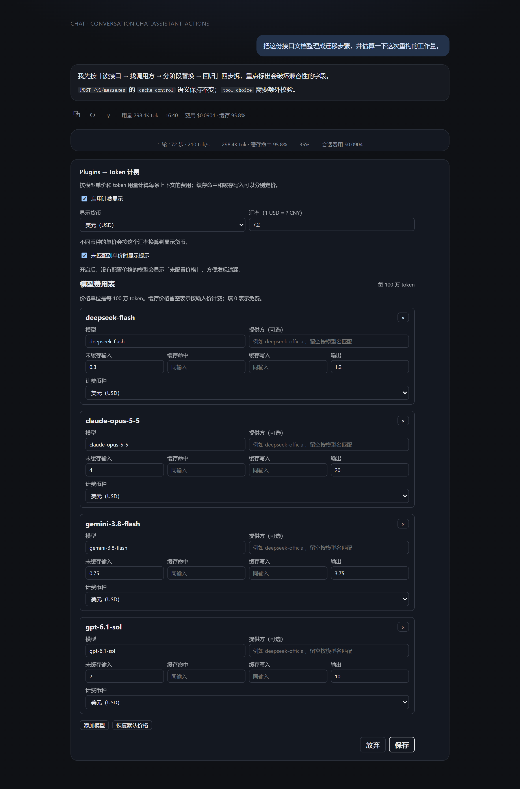

# dsh-token-billing

DeepSeek Harness（DSH）Web 插件：给每个 AI 模型配置一张费用表，按每个回合实际发生的 **未缓存输入 / 缓存读取 / 缓存写入 / 输出** token 计算费用，支持 **人民币（CNY）** 与 **美元（USD）**。每轮费用显示在该轮操作行的“用量”之后，输入框底部同时显示当前会话所有轮的合计。

金额精确到单轮对话级别，适合和厂商账单对照，也方便发现缓存命中率变化带来的成本差异。



## 计费方式

每个回合的费用按下面的公式计算：

```text
费用 = (未缓存输入 × 输入单价
      + 缓存读取 × 缓存命中单价
      + 缓存写入 × 缓存写入单价
      + 输出 × 输出单价) ÷ 1,000,000
```

- 单价统一按「每 100 万 token」填写，和厂商价目表一致。
- `缓存命中` / `缓存写入` 单价留空时按**输入单价**计费；填 `0` 表示免费。
- 输出 token 已包含推理 token（厂商的 `reasoningTokens` 是输出的子集），不会重复计费。
- 每条价格可以有自己的计费币种；显示时会按配置的汇率换算到显示货币（`1 USD = ? CNY`）。
- 一个回合跨多个模型时，如果能按步骤精确归属就分别计价；只有在无法拆分时才会按各模型单价的平均值估算，并标注「估算」。

## 显示位置

- **每轮费用**：注册在 Chat 的 `conversation.chat.assistant-actions` 槽位，作为该轮操作行的一个子项，排在“用量”之后，例如 `费用 $0.0904 · 缓存 95.8%`。悬停可以看到模型路由、各类 token 数量与对应金额、命中率、单价和计算公式。
- **会话合计**：注册在 `conversation.composer.dock` 槽位，显示在输入框底部统计栏“轮次 / 用量 / 上下文”的后面，例如 `会话费用 $0.0904`。会话合计会把当前已加载回合的费用逐轮相加；当完整会话日志比当前窗口更长时，用 durable `tokenUsage` 投影补齐缺失 token，并按最后一条已知路由的单价估算，显示为 `≈ 会话费用 …`。

没有匹配到单价时显示「未配置价格」，提示去补价格表。

## 安装

本插件是标准的 DSH profile bundle。

通过 Web UI（推荐）：

1. 打开左侧 **Plugins**。
2. **Add plugin → Install a third-party plugin**，填入本目录：
   ```
   C:\g-workspace\deepseek-harness\dsh-toolkit\dsh-token-billing
   ```
3. 安装后启用并重启 DSH（宿主半侧需要重新加载；浏览器半侧在下次打开页面时生效）。

命令行：

```sh
dsh plugin --profile desktop add C:/g-workspace/deepseek-harness/dsh-toolkit/dsh-token-billing
```

桌面端在 CLI 管理 `desktop` profile 前需要完全退出应用；也可以直接通过 Plugins 页安装。

卸载：

```sh
dsh plugin --profile desktop remove dsh-token-billing
```

## 配置

打开 **Plugins → Token 计费**，配置卡片提供：

| 设置 | 默认 | 说明 |
| --- | --- | --- |
| 启用计费显示 | `true` | 关闭后不渲染任何费用行 |
| 显示货币 | `USD` | `CNY`（人民币）或 `USD`（美元） |
| 汇率 | `7.2` | 1 USD 折合多少 CNY，用于跨币种换算 |
| 未匹配到单价时显示提示 | `true` | 没有价格的模型显示「未配置价格」 |
| 模型费用表 | Giant LiteLLM 文档价 | 每个模型的提供方、模型名、计费币种与四项单价 |

模型匹配顺序：

1. `provider` + `model` 精确匹配；
2. `provider = "*"` + `model`；
3. 只写 `model`（`provider` 留空）的通用行；
4. 同名模型的任意 provider 行（模型是主键，provider 用来区分同名模型）；
5. `provider` + `model = "*"`；
6. 最后是 `provider = "*"`、`model = "*"` 的兜底行。

模型名匹配不区分大小写。`cacheRead` / `cacheWrite` 留空表示按输入价；填 `0` 表示免费。

### 默认费用表

内置价格表来自 **Giant LiteLLM 接入指引（2026-10-30）**。价格单位：每 100 万 token，币种 USD。文档只给出输入/输出价，没有列出缓存价，因此 `cacheRead` / `cacheWrite` 留空，按输入价计费。

`deepseek-flash` / `deepseek-v4-pro` 有峰谷价，默认采用**高峰时段**价格；空闲价为 `deepseek-flash $0.15 / $0.6`、`deepseek-v4-pro $1.32 / $1.98`。文档中已划线的 `gemini-4-argon` 暂时不可用，未收录。

| 系列 | 模型 | 输入 / 输出（USD / 1M） |
| --- | --- | --- |
| Claude | `claude-opus-5-5` | 4.00 / 20.00 |
| Claude | `claude-sonnet-5-5` | 2.00 / 10.00 |
| Claude | `claude-haiku-5-5` | 0.10 / 0.50 |
| Gemini | `gemini-3.1-pro-preview` | 2.00 / 12.00 |
| Gemini | `gemini-3.8-flash` | 0.75 / 3.75 |
| Gemini | `gemini-3.5-flash-lite` | 0.30 / 2.50 |
| Gemini | `gemini-3.1-flash-lite` | 0.25 / 1.50 |
| DeepSeek | `deepseek-flash`（高峰） | 0.30 / 1.20 |
| DeepSeek | `deepseek-v4-pro`（高峰） | 0.66 / 3.96 |
| GPT (azure) | `gpt-6.1-sol` | 2.00 / 10.00 |
| GPT (azure) | `gpt-6.1-terra` | 1.00 / 5.00 |
| GPT (azure) | `gpt-6-astra` | 10.00 / 50.00 |
| GPT (azure) | `gpt-6-sol` | 2.00 / 10.00 |
| GPT (azure) | `gpt-6-luna` | 0.10 / 0.50 |
| GPT (azure) | `gpt-5.6-sol` | 4.00 / 20.00 |
| GPT (azure) | `gpt-5.6-terra` | 2.00 / 12.00 |
| GPT (azure) | `gpt-5.6-luna` | 0.20 / 1.20 |
| GPT (aws) | `global.openai.gpt-6.1-sol` | 2.00 / 10.00 |
| GPT (aws) | `global.openai.gpt-6.1-terra` | 1.00 / 5.00 |
| GPT (aws) | `global.openai.gpt-6-astra` | 10.00 / 50.00 |
| GPT (aws) | `global.openai.gpt-6-sol` | 2.00 / 10.00 |
| GPT (aws) | `global.openai.gpt-6-luna` | 0.10 / 0.50 |
| GPT (aws) | `global.openai.gpt-5.6-sol` | 4.00 / 20.00 |
| GPT (aws) | `global.openai.gpt-5.6-terra` | 2.00 / 12.00 |
| GPT (aws) | `global.openai.gpt-5.6-luna` | 0.20 / 1.20 |
| GLM | `glm-5.2` | 1.40 / 4.40 |
| GLM | `glm-5.3` | 1.19 / 4.17 |
| GLM | `glm-5.3-flash` | 0.11 / 0.42 |
| GLM | `glm-5.3-flashx` | 0.30 / 1.04 |
| KIMI | `kimi-k3` | 3.00 / 15.00 |
| MINIMAX | `minimax-m3` | 0.30 / 1.20 |

价格单位：每 100 万 token。

### 手写 profile patch

也可以直接改 profile 的 `cordis.patch.yml`（`desktop` profile 位于 `~/.dsh/profiles/desktop/cordis.patch.yml`）：

```yaml
- id: token-billing
  name: dsh-token-billing
  config:
    currency: USD
    exchangeRate: 7.2
    showUnpriced: true
    models:
      - model: deepseek-flash
        currency: USD
        input: 0.3
        output: 1.2
      - model: claude-opus-5-5
        currency: USD
        input: 4
        output: 20
```

## 数据来源

token 用量来自 Chat 快照里 `turn-tail` 节点携带的 `TurnTokenUsage`（由 `@deepseek-ai/dsh-token-meter` 的 `deriveTurnTokenUsage` 从会话事件折叠得到）。它把每次 provider 调用拆成互不重叠的桶：

- `uncachedInputTokens`：未命中缓存的输入；
- `cacheReadTokens`：缓存命中的输入；
- `cacheWriteTokens`：写入缓存的输入；
- `outputTokens`：输出（推理 token 是它的子集）。

因此本插件不估算 token，只对厂商实际报告的用量计价。

会话合计在已加载回合上沿用同一份 `turn-tail` 数据；当窗口没有覆盖整段会话时，再用 durable `tokenUsage` 投影的整段会话桶补齐差额，差额外按最后一条已知路由的单价估算，并显示 `≈`。

## 限制

- 一个回合内跨多个模型、且无法按步骤精确归属时，金额是估算值（会显示 `≈` /「估算」）。
- 单轮用量不完整（例如 provider 没有报告用量）时，该轮不显示费用，避免展示错误金额。
- 会话合计优先使用已加载回合的精确费用；当完整会话日志比当前窗口更长时，缺失 token 按最后一条已知路由的单价估算，并显示 `≈`。
- 每轮费用位于操作行；历史回合的操作行按 Chat 既有行为在悬停/聚焦时显示，最新回合始终显示。
- 只统计已完成回合；正在流式输出的回合在 `turn/end` 之后才出现在费用读数里。
- 明细放在原生 `title` 悬停提示中，触屏设备可能需要长按才能看到。
- 默认价格来自 Giant LiteLLM 接入指引（2026-10-30），实际账单以网关为准；文档没有缓存价，缓存 token 暂按输入价计费。

## 开发

```sh
node --check lib/client.js
node --check lib/index.js
node scripts/test-client.mjs
```

`scripts/test-client.mjs` 在 jsdom 里按 DSH 的模块加载方式执行浏览器半侧，覆盖计费、缓存命中、跨币种换算、多模型估算、匹配优先级、配置校验和两个 UI 的渲染。

`lib/` 是随包发布的手写源码（纯 JavaScript，无构建步骤）。宿主半侧是导出 `Config` 和 `apply` 的 ESM 入口；浏览器半侧使用 `window.__ModuleLoader__` 的工厂形式。
