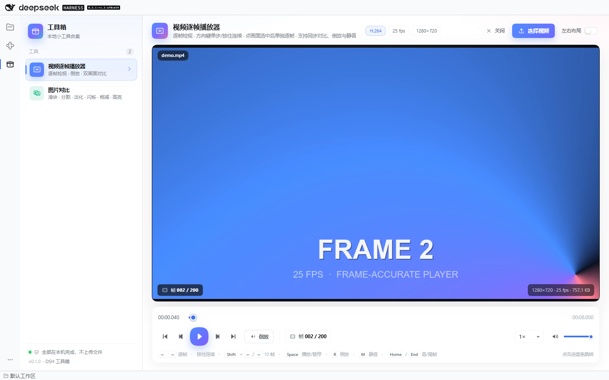
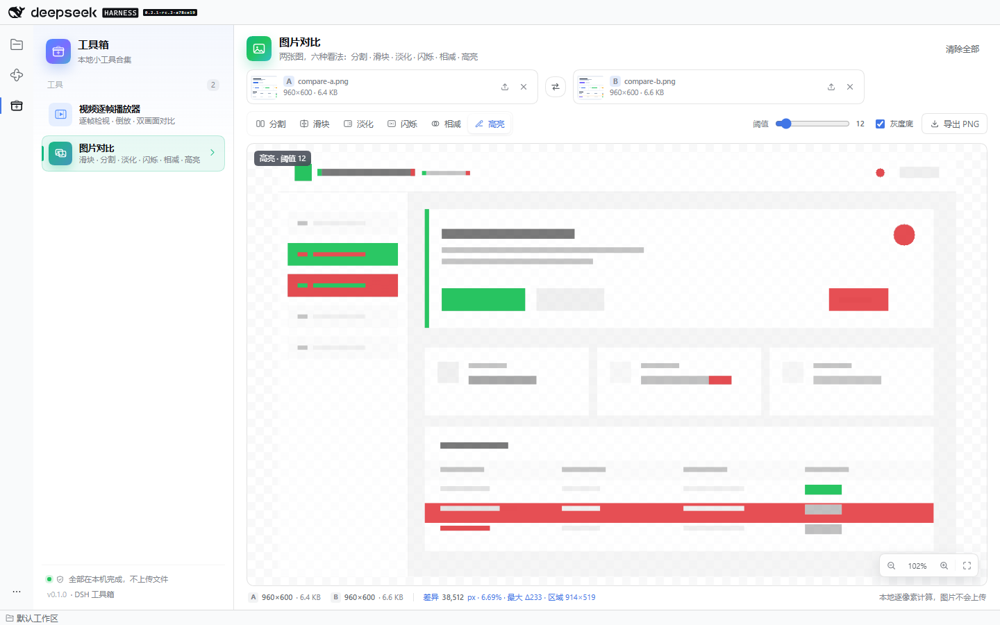

# dsh-toolbox

DeepSeek Harness（DSH）插件：把一组**本地小工具**收进左侧活动栏的一个入口。
点一下工具箱图标，左边是工具列表，右边是选中工具的完整界面；工具之间随时切换，
各自的文件、位置和视图都会保留。

目前内置两个工具：

1. **视频逐帧播放器** —— 原 `dsh-video-player` 插件的全部能力（逐帧、按住连续、倒放、
   左右双画面同步对比、每个画面独立起点、静音与速度）。
2. **图片对比** —— 两张图，六种看法：分割、滑块、淡化、闪烁、相减、高亮；带同步缩放、
   尺寸对齐、阈值/增益、差异统计与 PNG 导出。





## 功能

### 工具箱

- **一个活动栏入口**：整个插件只占一个图标（快捷键 `Ctrl+Alt+T`），不再为每个小工具各占一格。
- **左列表 / 右界面**：侧栏列出每个工具的名称、能力摘要与专属颜色；右侧整块区域就是工具界面。
- **切换不丢状态**：视频会暂停但保留文件与播放位置；图片对比保留两张图和当前视图，离开工具箱页面再回来也一样。
- **记住上次的工具**：下次打开工具箱直接回到上次使用的工具（`localStorage`）。
- **窄窗口自动收窄**：侧栏在窄宽度下折叠成图标条，工具仍可用。

### 视频逐帧播放器（子工具）

- **选择本地视频**：文件选择器或直接把视频拖进画面。MP4（H.264/AAC）是主路径；MOV、WebM 等只要浏览器能解码也能播放。
- **逐帧**：`←` / `→` 单帧，按住连续走帧；`Shift + ←/→` 一次 10 帧。帧号按 MP4 的 `stts` / `ctts` / `elst` 解析出的真实帧边界计算，seek 落在目标帧中点，不会跳到相邻帧。
- **左右同步对比**：打开「左右布局」后两个画面并排，共用底部时间线与播放/暂停/倒放/速度/静音；每个画面还有自己的进度条与「设置为起点」按钮。
- **选中画面单独逐帧**：点一个画面选中它（边框与「已选中」标签变化），此时方向键只走这个画面；点画面外恢复共享时间线。
- **倒放**：点「倒放」或按 `R`，从当前位置逐帧向后解码；再点一次停止。
- **进度跳转**：点/拖底部时间线跳到任意位置，松手时吸附到主轴画面的最近一帧，两个画面按各自起点同时跳转。
- **静音与速度**：`M` 静音、`↑`/`↓` 调音量；速度同时作用于正放与倒放。这三项偏好写在 `localStorage`。
- **不打断的状态**：切到别的工具会暂停画面但保留文件、起点、位置、音量与速度；回来即恢复。

### 图片对比（子工具）

- **两张图**：A 是原图，B 是对比图。点击、拖入或 `Ctrl+V` 粘贴截图；每一侧都能单独更换或移除，也可以一键交换 A/B。
- **分割**：两张图并排，缩放与平移同步 —— 放大左边某个角落，右边跟着到同一区域。
- **滑块**：拖动分隔线，让一张图从另一张下面显露出来；聚焦手柄后可用 `←` / `→` 微调。
- **淡化**：用不透明度滑杆把 B 渐渐叠到 A 上，重影会暴露位移或颜色变化。
- **闪烁**：在原位以可调间隔（150–1200 ms）交替显示 A 与 B，可随时暂停。
- **相减**：逐像素相减，相同处为黑，差异按增益（×1–×16）发亮；重新压缩或色彩配置造成的细微噪声会呈现为低强度灰雾，真正的改动是明亮的集中区域。
- **高亮**：把差异像素标成红色（B 更暗）或绿色（B 更亮），可以叠在 B 的灰度底上保留上下文；阈值（0–128）控制多大的差异才算变化。
- **缩放与平移**：滚轮以光标为中心缩放，拖动平移，双击或「适应」回到全图，点百分比切到 100% 实际像素。
- **尺寸不同也能比**：默认以 A 的画框为基准，B 等比适应；也可以选「拉伸填满」。顶部会给出尺寸不同的提示。
- **统计**：差异像素数、占比、最大通道差、变化区域包围盒，以及是否按缩小栅格采样。
- **导出 PNG**：相减/高亮视图可把结果导出为 PNG，方便贴进工单或评审。
- **完全本地**：图片在渲染进程里解码、在 canvas 上比较，不会上传，也没有宿主路由。

## 安装

插件是标准的 DSH profile bundle。

### 通过 Plugins 页面（推荐）

1. 打开 DSH 左侧活动栏的 **Plugins**。
2. **Add plugin → Install a third-party plugin**，填入本地目录：

   ```
   C:\g-workspace\deepseek-harness\dsh-toolkit\dsh-toolbox
   ```

3. 安装后启用它。宿主行在 DSH 启动时加载，客户端 bundle 在下次打开页面时生效 ——
   装好后重启 DSH（或按 `Ctrl+R` 刷新窗口）最稳妥。

### 通过 CLI

```sh
# Web profile
dsh plugin --profile web add C:/g-workspace/deepseek-harness/dsh-toolkit/dsh-toolbox

# 桌面端 profile（CLI 管理 desktop profile 前建议完全退出应用）
dsh plugin --profile desktop add C:/g-workspace/deepseek-harness/dsh-toolkit/dsh-toolbox
```

卸载：

```sh
dsh plugin --profile desktop remove dsh-toolbox
```

> 桌面端自带的 CLI 在 `<安装目录>\resources\runtime\cli\bin\dsh.cmd`，版本与桌面端一致
> （当前 0.2.1-rc.2）。全局 `dsh` 可能是更旧的版本，安装前请用 `dsh --version` 确认。

### 从 dsh-video-player 迁移

`dsh-video-player` 不再是独立插件：它的界面与引擎已成为工具箱的第一个子工具。
已经装过旧插件的 profile，请先移除旧行（`dsh plugin --profile desktop remove dsh-video-player`），
再安装 `dsh-toolbox`，否则活动栏里会同时出现两个视频入口。

## 使用

### 打开

点左侧活动栏的工具箱图标，或按 `Ctrl+Alt+T`。左边点选工具，右边立即切换。
侧栏底部会显示「全部在本机完成，不上传文件」与版本号。

### 视频逐帧播放器

1. 点「选择视频」或把 MP4 拖进画面。
2. 用 `←` / `→` 检视每一帧；按住不放会连续走帧。
3. 需要倒查时点「倒放」或按 `R`；需要定位时直接点进度条。
4. 需要并排对比时打开右上角的「左右布局」：两个画面各自有进度条和「设置为起点」，
   底部时间线同时驱动两边；点画面选中后方向键只走选中的画面。

### 图片对比

1. 把原图拖到左边卡片、对比图拖到右边卡片（或分别点击选择）。
2. 两张都就绪后自动进入对比界面，默认「分割」。
3. 在顶部切换视图；右侧滑杆与开关只影响当前视图。
4. 要看「哪里变了」用「相减」或「高亮」；要确认「有没有挪位」用「滑块」或「闪烁」。
5. 需要留档时点「导出 PNG」。

快捷键（工具箱页内）：

| 按键 | 动作 |
| --- | --- |
| `Ctrl+Alt+T` | 从任意位置打开工具箱 |
| `←` / `→` | 视频逐帧（按住连续）；图片滑块模式下微调分隔线 |
| `Shift` + `←` / `→` | 视频一次 10 帧 |
| `Space` | 视频播放 / 暂停 |
| `R` | 视频倒放 |
| `M` | 视频静音 |
| `Home` / `End` | 视频首帧 / 尾帧 |
| `Ctrl+V` | 在图片对比里粘贴截图 |

> 视频的方向键只在「视频工具可见且播放器持有焦点」时生效：切到图片对比后，
> 方向键不会再偷偷切换视频帧。

## 支持范围与限制

- **视频**：DSH Web / 桌面端同一套 Chromium + `ffmpeg.dll`；H.264/AAC 已做端到端验证，HEVC 是否可播取决于系统解码器。
- **视频帧率**：标准 MP4/MOV 读精确帧表；分片 MP4、WebM 等自动降级为按 30 fps 估算，并允许手动改帧率。
- **图片格式**：PNG / JPEG / WebP / GIF / BMP / AVIF 走浏览器解码；HEIC 在大多数 Chromium 里不能解码，会给出明确错误。
- **动图**：GIF 只取第一帧比较。
- **SVG**：可以显示；如果引用了外部资源导致 canvas 被污染，会提示无法逐像素读取。
- **超大图**：逐像素比较最多在约 1200 万像素的栅格上进行（超出时等比缩小）；画面仍用原图显示，统计栏会注明采样尺寸。
- **透明度**：相减/高亮会把 alpha 也计入差异；预览用棋盘格表示透明区域。
- **视角同步**：分割视图的两个画面共用缩放与平移；两张图宽高比不同时，B 按对齐方式放入 A 的画框。

## 数据与隐私

- 视频与图片都通过 `<input type="file">` / 拖放 / 剪贴板进入渲染进程，用 `URL.createObjectURL` 读取，**不会上传、不会写入临时目录**。
- 插件没有宿主路由、没有第二个端口、没有网络请求。
- 只把少量偏好写进 `localStorage`：
  - `dsh-toolbox:active-tool`：上次使用的工具；
  - `dsh-toolbox:video:prefs`：音量、静音、播放速度。
- 视频文件、播放位置、起点，以及图片对比的两张图与视图选项只存在于内存中；关闭页面或重启 DSH 后清空。

## 兼容性

- 面向 **DSH 0.2.1-rc.2** 开发，`engines.dsh` 为 `>=0.2.1-rc.2 <0.3.0`；在当前安装的 DSH 0.2.1-rc.2 上做过真实 Web 端到端验证。
- 浏览器半侧通过 `dsh.client`（`platform: web`）加载，注册到 `shell.activitybar.items` / `shell.activity` 插槽；React 由 DSH 的 platform module 表提供。
- 宿主半侧 `lib/index.js` 是空 `apply()`：本插件不需要宿主能力，只保留 Bundle 行的契约。
- 支持 DSH Web 与桌面端（`dsh-app://` / 本机 HTTP 页面均可）。

## 开发

```bash
npm install
npm run typecheck
npm run build          # lib/index.js + lib/client.js
npm run test:parser    # Node 直接导入 TS：MP4 帧表解析
npm run test:client    # jsdom：槽位注册、工具箱壳、工具切换、记忆
node scripts/make-fixtures.mjs
npm run test:e2e       # 隔离的 dsh web + Chrome：视频逐帧、六种视图、导出、截图
npm run screenshot     # 只重拍 README 截图（需要 DTB_URL）
```

目录结构：

```
src/client/index.tsx          活动栏入口 + 插槽注册 + 样式注入
src/client/ui/App.tsx         工具箱壳（左列表 / 右界面 / 记忆）
src/client/tools/registry.tsx 工具目录与共享引擎
src/client/tools/video/       视频逐帧播放器（引擎、MP4 帧表、UI）
src/client/tools/image/       图片对比（diff、store、UI、样式）
src/host/index.ts             空宿主入口
scripts/                      构建、fixtures、客户端测试、端到端测试、截图
```

## License

MIT
