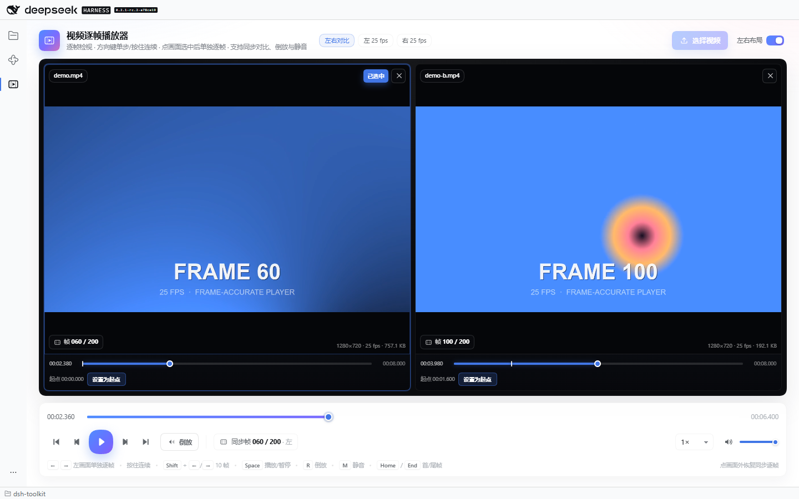

# dsh-video-player

DeepSeek Harness（DSH）插件：把**本地视频逐帧播放器**放进左侧活动栏。点一下胶片图标，右侧整页就是播放器 —— 选择本地 MP4，用左右方向键一帧一帧地看；按住方向键连续走帧，也可以倒放、点进度条跳转、随时静音。打开「左右布局」后，两个画面并排，每个画面下方都有自己的进度条和「设置为起点」按钮；点画面选中后方向键单独逐帧，点画面外则恢复底部同步时间线。



## 功能

- **左右同步对比**：在「选择视频」按钮右侧打开「左右布局」开关，舞台变成左右两个画面。每个空画面都有「选择视频」按钮；加载后右上角出现 `×`，点它只关闭该画面，占位的「选择视频」按钮会重新出现。两个画面共用底部进度条、播放/暂停、倒放、速度与静音，但每个画面下方还有自己的独立进度条和「设置为起点」按钮。
- **选择本地视频**：文件选择器或直接把视频拖进对应画面。MP4（H.264/AAC）是主路径；MOV、WebM 等只要浏览器能解码也能播放。
- **选中画面单独逐帧**：点一个画面（或它下方的进度条）会选中它，边框和「已选中」标签变亮；此时 `←` / `→` 只逐帧移动这个画面，另一个画面不动。点画面外的顶栏、底部控制条或空白处取消选中，方向键重新控制底部共享时间线（两个画面一起走）。
- **起始位置**：每个画面下方有一条自己的进度条和一个「设置为起点」按钮。拖动/点击进度条定位到目标帧，或先选中画面用 `←` / `→` 微调，再点「设置为起点」，就把该画面当前帧设为入点；共享时间线回到 0，两个画面分别停在自己的起点。起点会吸附到视频帧边界，进度条上的白色竖线标出起点位置。
- **逐帧播放**：`←` / `→` 单次按下一帧，按住连续走帧（约 300 ms 后开始重复，松手即停）；`Shift + ←/→` 一次 10 帧。未选中画面时两个画面同步走帧；选中画面时只走选中的那个。每次走帧都会等浏览器真正画出目标帧再更新计数。
- **反向播放**：点「倒放」或按 `R`，从当前位置持续向后逐帧播放；再点一次或到同步区间开头停止。速度选择同时作用于正放和倒放。
- **进度条跳转**：点击或拖动**底部共享进度条**到任意位置，松手时吸附到主轴画面的最近一帧；两个画面按各自的起始位置同时跳转。如果跳转前正在播放/倒放，会从新位置继续。每个画面自己的进度条则只移动那个画面。
- **静音**：静音按钮、`M` 快捷键、音量滑杆同时作用于两个画面；静音状态、音量和速度会记在 `localStorage`，下次打开沿用。
- **正放**：`Space` 播放/暂停；`Home` / `End` 跳到同步区间首/尾帧；`↑` / `↓` 调整音量。
- **帧信息**：每个画面左下角显示自己的帧号 / 总帧数，下方进度条显示该画面的绝对时间；底部传输条显示共享时间线的同步帧。
- **不打断的页面状态**：切回会话时画面暂停但保留文件、起点、位置、音量与速度；再点活动栏图标回到原处。

## 安装

插件是标准的 DSH profile bundle。

### 通过 Plugins 页面（推荐）

1. 打开 DSH 左侧活动栏的 **Plugins**。
2. **Add plugin → Install a third-party plugin**，填入本地目录：
   ```
   C:\g-workspace\deepseek-harness\dsh-toolkit\dsh-video-player
   ```
3. 安装后启用它。宿主行在 DSH 启动时加载，客户端 bundle 在下次打开页面时生效 —— 装好后重启 DSH（或按 `Ctrl+R` 刷新窗口）最稳妥。

### 通过 CLI

```sh
# Web profile
dsh plugin --profile web add C:/g-workspace/deepseek-harness/dsh-toolkit/dsh-video-player

# 桌面端 profile（CLI 管理 desktop profile 前建议完全退出应用）
dsh plugin --profile desktop add C:/g-workspace/deepseek-harness/dsh-toolkit/dsh-video-player
```

卸载：

```sh
dsh plugin --profile web remove dsh-video-player
```

> 桌面端自带的 CLI 在 `<安装目录>\resources\runtime\cli\bin\dsh.cmd`，版本与桌面端一致（当前 0.2.1-rc.2）。全局 `dsh` 可能是更旧的版本，安装前请用 `dsh --version` 确认；不匹配时优先用 Plugins 页面或桌面端自带的 CLI。

## 使用

### 单画面

1. 点左侧活动栏的胶片图标（或 `Ctrl+Alt+V`）打开「视频逐帧播放器」。
2. 点「选择视频」或把 MP4 拖进画面。视频只在本机浏览器中解码，不会上传。
3. 用 `←` / `→` 检查每一帧；按住不放可以连续走帧。
4. 需要反向检查时点「倒放」或按 `R`；需要定位时直接点进度条。
5. 需要听声音时点静音按钮取消静音，或按 `M` 切换。

### 左右同步对比

1. 点「选择视频」右侧的「左右布局」开关，舞台变成左右两个画面。
2. 每个空画面点「选择视频」选择视频，或把文件拖到对应画面。两个都加载后，顶部「选择视频」按钮会禁用 —— 用每个画面右上角的 `×` 先关闭再更换。
3. 每个画面下方都有自己的进度条和「设置为起点」按钮。拖动该画面的进度条到目标位置（或先点画面选中，用 `←` / `→` 逐帧微调），再点「设置为起点」；该画面停在新的入点，共享时间线回到 0。对另一个画面重复。
4. 点一个画面会选中它（边框和「已选中」标签变亮）。此时 `←` / `→`、`Shift + ←/→` 只对选中画面生效，方便单独检查或对齐另一条视频。
5. 点画面外的顶栏、底部控制条或空白处取消选中，方向键重新控制底部共享进度条，两个画面一起走。
6. 底部进度条、播放/暂停、倒放、速度、静音同时控制两个画面。共享进度条显示两个画面共同的重叠区间（取各自剩余时长的较小值）。
7. 想换某一个视频，点该画面右上角 `×`；只关闭这个画面，另一个保持不变，「选择视频」按钮重新出现。
8. 关闭「左右布局」回到单画面，左侧视频仍然保留；右侧画面会留在内存里，再次打开开关时恢复。

> 单画面模式下如果左侧视频带着非零起点（例如从左右布局切回来），顶栏会显示「起点 …」小标签，点一下即可把起点清零。

### 快捷键

| 按键 | 动作 |
| --- | --- |
| `←` / `→` | 上一帧 / 下一帧；**按住连续**；左右布局未选中画面时两个画面同步，选中时只走选中画面 |
| `Shift` + `←` / `→` | 后退 / 前进 10 帧（同样遵循选中状态） |
| `Space` | 播放 / 暂停 |
| `R` | 开始 / 停止倒放 |
| `M` | 静音 / 取消静音（两个画面） |
| `Home` / `End` | 同步区间第一帧 / 最后一帧 |
| `↑` / `↓` | 音量 +5% / -5% |
| `Ctrl+Alt+V` | 从任意位置打开播放器 |

> 左右布局中，鼠标点画面会选中它；点同一个画面不会取消，点画面外的顶栏、底部控制条、空白处或另一个画面才会切换/取消选中。选中状态只影响方向键，不影响 `Space`、`R`、`M` 等全局操作。

> 焦点的规则：播放器页面内的按键才会被接管；光标在 DSH 的输入框、下拉框、弹窗里时不会抢方向键。点一下画面或传输条即可把键盘焦点交还播放器。

## 帧精确是怎么做的

浏览器只提供 `video.currentTime`，它不告诉你“一帧从哪里开始、到哪里结束”。只按 `1/30` 秒步进会在 25 fps、23.976 fps、VFR 或带 B 帧的视频上跳帧/重复帧。

本插件在打开文件时读取 MP4 的 `moov`（只读元数据，不读媒体数据）：

- `stts`：每个 sample 的时长，得到每帧的精确起点；
- `ctts`：B 帧的 composition offset，按显示顺序（CTS）重新排序；
- `elst`：编辑列表的起始偏移，把首帧对齐到 0；
- `mdhd` / `stsd`：媒体 timescale、编码与分辨率。

然后每次走帧都把 `currentTime` 设为**目标帧的中间点**（`start + duration / 2`），并等 `seeked` 与 `requestVideoFrameCallback` 确认新帧已经画出来。这样即使关键帧间隔很长，落点也不会偏到相邻帧。倒放是同一个原语的逆向循环：`targetFrame--` → seek → 等绘制 → 按帧时长节流。

这条路径完全在浏览器里完成，不需要 ffmpeg、宿主路由或额外端口。

### 帧率来源

- 标准 MP4 / MOV：读取精确帧表，顶栏显示 `H.264`、`25 fps` 等。
- 分片 MP4（`moof`、空的 `stbl`）、WebM 或其他无法解析的容器：自动降级为按 30 fps 估算，并在顶栏标出「帧率估算」；此时传输条会出现帧率下拉框，可以改成 24 / 25 / 30 / 50 / 60 / 23.976 / 29.97 / 59.94 等，帧表会立即按新帧率重建。
- VFR 视频：帧表保留每一帧自己的时长；顶栏显示的是平均帧率，走帧仍按实际帧边界。

### 左右同步的时间线

- 每个画面有一个**入点** `start`。共享时间线上的位置 `t` 对应画面时间 `start + t`；所以左边第 20 帧、右边第 40 帧可以同时出现在“同步 0 秒”。
- **共享时长**取两个已加载画面 `duration - start` 的较小值。两边没有重叠时，进度条和播放按钮会禁用并给出提示。
- **主轴画面**是第一个已加载的画面（优先左侧）。逐帧时主轴前进一帧，另一个画面 seek 到同一 `t`。两个视频帧率相同时就是各走一帧；帧率不同时以主轴节拍为准，另一个画面显示覆盖该时刻的帧（不会为了凑帧率而跳过主轴帧）。
- 播放时先把两个画面 seek 到 `start + t`，再一起 `play()`；播放循环每帧检查一次漂移，偏差超过 150 ms 就把跟随画面拉回主轴时间。到达共享时长后两个画面一起停。
- 倒放使用同一套逐帧 seek 原语反向推进，两个画面一起退。
- 每个画面下方有自己的进度条，点击/拖动只移动该画面；「设置为起点」把该画面当前帧设为入点，起点吸附到该画面的帧边界，共享时间线归零，两个画面分别停在自己的起点。
- 选中画面时方向键只走该画面，**不会改变底部共享时间线**；取消选中后第一次方向键会按底部时间线的位置重新同步两个画面。

## 支持范围与限制

- **MP4**：H.264/AAC 已在 DSH Web（Chrome）里做过真实端到端验证；DSH 桌面端使用同一套 Chromium + `ffmpeg.dll`（其中包含 H.264/AAC/HEVC 解码器）。H.265/HEVC 是否可播取决于浏览器与系统解码器，不能解码时会显示明确错误。
- **MOV**：同为 ISO-BMFF，帧表通常可读；能否播放取决于浏览器。
- **WebM / OGG**：浏览器能播就能播，但帧表是估算的，需要手动选帧率。
- **混合帧率**：逐帧以主轴画面的帧节拍推进；两个视频帧率不同时，跟随画面不一定每一步都换帧。需要严格 1:1 逐帧时请用相同帧率的素材，或把帧率更高的放在左侧当主轴。
- **双画面解码**：两个视频同时播放/倒放会同时占用解码器；4K 双画面在低配机器上可能掉帧或倒放变慢。
- **音频是全局的**：两个画面共用静音和音量，正放时两条音轨会混合；需要只听一个时可以先关闭另一个画面。
- **同步时长取重叠区间**：两个画面的入点不同，底部进度条只覆盖两边都还有画面的那段；其中一边接近结尾时同步区间会变短，这是有意的行为。
- **倒放速度**：受解码器 seek 速度限制。长 GOP 视频每一帧都要重新定位，倒放可能明显慢于 1×；这是浏览器 `<video>` 不能负速播放的客观限制，不是跳帧。
- **倒放时没有声音**：倒放保持 `<video>` 暂停，只做逐帧 seek；正放和逐帧检查时声音正常。
- **大文件**：媒体数据留在浏览器的 blob URL 里，插件只读 `moov`；关闭文件时立即释放。
- **帧号约定**：界面使用 1-based 帧号（第一帧显示 `1`）；起点按秒显示，并吸附到帧边界。

## 数据与隐私

- 视频文件通过 `<input type="file">` / 拖放进入渲染进程，用 `URL.createObjectURL` 播放；**不会上传、不会写入临时目录**。左右布局下两个文件各自持有一个 blob URL。
- 插件没有宿主路由、没有第二个端口、没有网络请求。
- 只有音量、静音、播放速度三个偏好写在 `localStorage` 的 `dsh-video-player:prefs` 键里；起点和文件不持久化。
- 关闭某个画面只释放该画面的视频句柄；关闭整个页面或卸载插件会释放两个。

## 兼容性

- 面向 **DSH 0.2.1-rc.2** 开发，`engines.dsh` 为 `>=0.2.1-rc.2 <0.3.0`；在当前安装的 DSH 0.2.1-rc.2 上做过真实 Web 与 Chrome 端到端验证。
- 浏览器半侧通过 `dsh.client`（`platform: web`）加载，注册到最新的 `shell.activitybar.items` / `shell.activity` 插槽；React 由 DSH 的 platform module 表提供。
- 宿主半侧 `lib/index.js` 是空 `apply()`：本插件不需要宿主能力，只保留 Bundle 行的契约。
- 支持 DSH Web 与桌面端（`dsh-app://` / 本机 HTTP 页面均可）。

## 开发

```bash
npm install
npm run build       # lib/index.js（宿主）+ lib/client.js（浏览器）
npm run typecheck
npm run test:parser # MP4 帧表单元测试
npm run test:client # jsdom 中的 DSH 插槽冒烟测试
npm test            # fixtures + parser + client
```

`npm test` 里的 `fixtures` 步骤需要 **ffmpeg**（或 `FFMPEG` 环境变量）和带 Pillow 的 **Python**（或 `PYTHON` 环境变量）；测试视频会生成在 `fixtures/`，其中每一帧用 7 个二进制色块编码帧号，浏览器测试可以直接从 canvas 读回帧号。

真实浏览器端到端测试需要一个启用了本插件的 DSH Web profile：

```bash
# 1) 准备一个测试 profile（base + web-app + 本插件）
dsh plugin --profile video-test add C:/g-workspace/deepseek-harness/dsh-toolkit/dsh-video-player

# 2) 启动 Web 服务（注意把 profile 的 web-app 行也带上；见下方说明）
dsh --profile video-test --port 57999 --no-open

# 3) 用打印出来的带 token URL 跑测试
npm run test:e2e -- "http://127.0.0.1:57999/?token=…"
```

> `dsh plugin` 首次创建 profile 时只加入 `@deepseek-ai/dsh-base`。如果是从空 profile 开始，需要在 `~/.dsh/profiles/video-test/package.json` 的 `dsh.profile.bundles` 里同时保留 `@deepseek-ai/dsh-web-app`。

截图同样针对真实 DSH 页面生成：

```bash
npm run screenshot -- "http://127.0.0.1:57999/?token=…"
```

测试覆盖：单帧前进/后退、按住连续、Shift+10、进度条点击跳转、静音按钮与 `M`、连续倒放、正放、分片 MP4 降级与手动修正帧率；以及左右布局开关、两个空画面的「选择视频」、每格独立进度条、点画面/进度条选中且只走选中画面、点画面外取消选中后方向键恢复同步、每格「设置为起点」（0.8 s / 1.6 s）、共享 3.2 s 区间、单步与按住时两个画面同步、共享进度条落点、同步正放、同步倒放、双画面静音、`×` 只关闭一侧、关闭布局后左侧保留。每次走帧都从两个视频画面里分别解码出真实帧号，落点或同步偏移不对都无法通过。

### 结构

```
src/host/
  index.ts        空宿主入口（只满足 Bundle 行契约）
src/client/
  index.tsx       活动栏图标、活动页、Ctrl+Alt+V
  engine.ts       双画面引擎：各自帧表/起点 + 共享时间线、逐帧、倒放、同步播放
  mp4.ts          stts/ctts/elst 帧表解析与估算回退
  ui/App.tsx      单画面/左右布局页面、选中画面、每格进度条与起点按钮、共享传输条
  icons.tsx       SVG 图标
  styles.ts       按 DSH 主题 token 编写的样式
scripts/
  build.mjs       esbuild 打包两个半侧
  make_fixtures.py / make-fixtures.mjs
  test-parser.mjs test-client.mjs test-e2e.mjs screenshot.mjs
lib/              构建产物（随包发布）
fixtures/         测试视频（可重新生成；demo.mp4/demo-b.mp4 用于截图）
```

## 出处

参考了仓库内 [`dsh-music-player`](../dsh-music-player) 的活动栏 / 客户端 Bundle 组织方式，以及 [`dsh-sound-desk`](../dsh-sound-desk) 的按需加载与主题样式做法。帧表解析、播放器引擎、UI 与测试为本插件自有实现。

## 许可

MIT。
