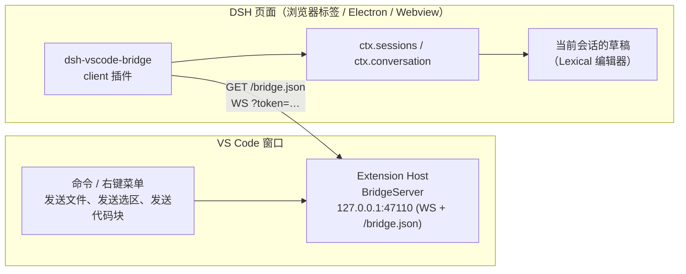

# VS Code → 运行中的 DSH 会话输入框：实现方案

> 目标：在 VS Code 里选中一段代码或一个文件，一键送进**正在运行的那个 DSH 实例**当前会话的输入框（composer），变成一个引用 chip 或一段待发送文本，由你确认后再按 Enter。
>
> **实现状态（2026-10-20）**：方案 S 已落地。DSH 侧改动见 `dsh-toolkit/vscode-dsh-send/DSH-PATCH.md`，VS Code 扩展见本目录，已构建出 `vscode-dsh-send-0.1.0.vsix`。实际落点与下文 §11 的示意略有差异：Host 入口放在 `packages/bundle/web-app/src/external-input.ts`，客户端处理放在 `packages/client/ui-reference/src/client/index.ts`，没有新建独立包（避免改动工作区构建图）。已验证：路由 401/400/202 超时、连接页面后 `200 {ok:true}`、composer 出现 `extension.ts:10-12` chip、点击后右侧栏滚动到第 10 行。

---

## 0. 结论（先看这一段）

1. **DSH 的输入框是浏览器端状态，Host 没有"写草稿"的 API。** 所以任何"从 VS Code 发到输入框"的方案，最终都必须在一段跑在 DSH 页面里的 JS 中执行插入动作。
2. 有三条可行路径：
   - **A. 内嵌（embed）**：VS Code 用 Webview 加载 DSH 页面（`?embed=1`），通过 `postMessage` 发送 `dsh.insert-reference`。官方扩展 `apps/vscode` 已经这么做。
   - **B. 伴生插件（attach，推荐）**：VS Code 扩展在本机开一个 loopback WebSocket；DSH 侧装一个很小的 client 插件，收到消息后调用 `ctx.conversation.input` 写进**当前打开会话**的草稿。**这是唯一能写进"你正在用的浏览器标签 / 桌面 App 输入框"的方式。**
   - **C. Host RPC 直发**：扩展直接 `POST /api/session/prompt`，把内容作为一条用户消息提交。不经过输入框，立即执行；适合做"发送并运行"。
3. **推荐组合：B 为主 + C 作为可选的"发送并执行" + A 作为不想装插件时的降级。**
4. 如果你只是希望"在 VS Code 侧边栏里用 DSH"，不用写代码：仓库里已有现成扩展
   `C:\g-workspace\deepseek-harness\deepseek-harness-vscode\apps\vscode`（含已打包的 `dsh-vscode-0.1.0-rc.5.vsix`），它自带"发送到 DSH"。

---

## 1. 先把"输入框"这件事拆开

| 层 | 谁拥有它 | 外部 HTTP 能做什么 |
|---|---|---|
| Host（Node 进程，`dsh` / 桌面 App 内核） | Session 日志、Agent、工具、`session.prompt` RPC | 只能**提交**一条用户消息；不能写草稿 |
| Client（Web GUI 页面：浏览器标签 / Electron 窗口 / VS Code Webview） | 草稿文本、引用 chip、光标、待上传附件 | 只有**页面内**的 JS 能写 |
| VS Code 扩展 | 编辑器选区、文件路径、终端内容 | 必须经上面两层之一落地 |

因此：

- "发送到输入框" = 在 DSH 页面进程里执行 `insertReference()` / `setDraft()`。
- "发送并让它开始干活" = 调 Host 的 `session.prompt`，或页面里执行 `input.submit()`。

DSH 的草稿是**每个客户端各自一份**的（存在页面里，不落 Host）。同一个 Session 在两个标签页里打开，两个标签页的草稿互不影响。这条决定了 A 和 B 的本质区别，见 §3。

---

## 2. DSH 已经提供的四个接缝（都不用改核心）

### 2.1 内嵌协议：`dsh.insert-reference`（现成，零 DSH 改动）

官方 VS Code 扩展把 `dsh web` 实例装进 Webview：

```
Webview iframe  src = http://127.0.0.1:<port>/?token=<launch-token>&embed=1&cwd=<workspace>
        │  postMessage({ source:'dsh-vscode', type:'insert-reference', id, token, ref, label })
        ▼
DSH 页面  packages/client/ui-conversation/src/client/embed-input.ts
        └─ deps.insertFileReference(sessionId, { source:'reference', ref, label, appearance:'file', clipboardText:ref })
        └─ 回 postMessage({ source:'dsh-web', type:'insert-reference-result', id, ok, error })
```

关键代码：

- 协议实现：`packages/client/ui-conversation/src/client/embed-input.ts`（校验 token、找当前会话、调用 `insertFileReference`）。
- 安装位置：`packages/client/ui-conversation/src/client/apply.ts:208`。
- `embed=1` 的识别：`apps/web/src/main.ts:7` 设置 `document.documentElement.dataset.dshEmbed = '1'`。
- 鉴权：`packages/client/connection/src/browser-auth.ts:273` —— **只有 `acceptLaunchToken` 开启且 URL 同时带 `embed=1` 时，带 token 的 index 才直接返回**（否则 303 重定向会把 token 从 URL 去掉，页面里的 `pageToken()` 就变 undefined，插入会被判 `unauthorized`）。
- `acceptLaunchToken` 默认值：`packages/client/connection/src/index.ts:132`，`process.env.DSH_VSCODE === '1'` 时为 true，也可在 profile 配置里显式打开。

**适用**：页面由扩展自己承载（扩展启动实例，或扩展把已运行实例嵌进 Webview）。**不适用**：给浏览器标签页、桌面 App 窗口的输入框发东西——`postMessage` 只能发给自己的子 frame，且非 embed 页面根本不装监听器。

> **版本提醒**：embed 通道是这份 checkout（0.1.6-alpha.2）里的实现。你机器上运行的是桌面版 **0.2.1-rc.2**，在它的 `resources/app.asar` 里搜不到 `insert-reference-result` / `dshEmbed` / `isVscodeEmbed` 这些字符串（同一份 asar 里 `slash/input-insert-reference`、`input.for`、`insertReference` 都在）。这强烈提示：**0.2.1 的 Web 端可能没有 embed 输入通道**。因此 A/A' 在这台机器上要先验证或改用 checkout 的 CLI；B 不受影响（它走的是插件 API，0.2.1 里已确认存在）。

### 2.2 客户端插件 API：`ctx.conversation.input`（attach 方案的核心）

DSH 的 Web GUI 支持第三方 **client 插件**（`dsh.client`），它跑在页面里，能拿到会话作用域和输入框控制器：

```ts
// 公开服务 ctx.conversation = IConversation
// packages/client/ui-conversation/src/client/service.ts:40
interface IConversation {
  readonly input: SessionInputResolver          // 每个会话的输入控制器
  readonly blocks: ComposerBlocks
  send(text: string): Promise<void>             // 直接发一条（走 Host）
  cancel(): Promise<void>
  loadOlder(): Promise<void>
}

// packages/client/ui-conversation/src/client/contract/input.ts:176
interface SessionInput {
  setDraft(text: string): void                  // 替换整份草稿
  insertReference(ref: ReferenceInsert, span: TokenSpan): boolean   // 插入引用 chip
  submit(mode?: 'queue' | 'steer'): void        // 等于按 Enter
  notify(level: 'info' | 'error', text: string): void
  focus(): void
  readonly state: SnapshotStore<InputState>     // draft / draftRev / phase
}
```

拿到某个会话的 `SessionInput`：

```ts
const scope = ctx.sessions.scope(sessionId)          // AgentContext | undefined（必须已被 retain）
const input = ctx.conversation.input.for(scope)      // SessionInput
```

当前打开的是哪个会话：`ctx.sessions.list.getSnapshot().byId` 里 `retainedBy.mainView > 0` 的那一行（embed 实现就是这么选的，见 `apply.ts:213`）。

> 注意：`SessionInput` 目前**没有** `insertReferenceAtCaret`（只有包内 `SessionInputShell` 有）。`insertReference` 需要一个 `{ start, end, draftRev }` 的 span，插件可以用"草稿末尾"作为插入点；想要"落在光标处"，建议给上游补一个 5 行的公开方法（见 §9.1）。

### 2.3 Host RPC：`session.prompt`（"直接发送"）

- 端点：`POST /api/session/prompt`，body `{ args: SessionPromptRequest }`
- 请求体（`packages/api/session-controller/src/types.ts:313`）：
  ```json
  {
    "args": {
      "requestId": "<client-minted id>",
      "sessionId": "…",
      "mode": "queue",
      "content": [{ "type": "text", "text": "…" }]
    }
  }
  ```
- 鉴权：浏览器 cookie，或 `x-dsh-token` 头（同样要求 `acceptLaunchToken`）。
- 效果：绕过输入框直接进 Agent inbox（`queue` 或 `steer`）。**不是**写草稿。

### 2.4 反向通道的先例

官方扩展还演示了 harness 插件 → VS Code 的桥：启动子进程时传 `DSH_VSCODE=1`、`DSH_VSCODE_BRIDGE=<url>`、`DSH_VSCODE_BRIDGE_TOKEN`，插件 `POST /open-file` / `/open-diff`（`apps/vscode/src/bridge.ts`）。双向桥在这个项目里是既有模式，可直接借鉴其 token/超时写法。

### 2.5 版本兼容性（本机实测，2026-10-20）

从 `C:\Users\heyang\AppData\Local\Programs\DeepSeek Harness\resources\app.asar`（桌面版 0.2.1-rc.2）里按字符串检索：

| 探针 | 结果 | 含义 |
|---|---|---|
| `__ModuleLoader__`、`__DSH_BOOT__`、`dsh.client`、`clientModules` | 存在 | client 插件体系可用，B 方案的前提成立 |
| `conversation.input`、`input.for(`、`setDraft`、`insertReference(ref` | 存在 | 插件可用的输入框 API 存在 |
| `slash/input-insert-reference` | 存在 | scoped 插入事件存在 |
| `retainedBy`、`mainView` | 存在 | 当前会话选择逻辑可用 |
| `insert-reference-result`、`dshEmbed`、`isVscodeEmbed` | **未找到** | 该版本的 Web 端可能没有 embed 输入通道（A/A' 需先验证） |

> 检索是启发式的（字符串可能被拼接/按需加载），但足以决定"先做 B、A 只作备选"。

---

## 3. 三个方案对比

| | A. 内嵌自启 | A'. 内嵌附着 | **B. 伴生插件桥** | C. Host 直发 |
|---|---|---|---|---|
| 目标实例 | 扩展自己启的 `dsh web` | 已运行的实例，嵌进 Webview | **已运行的实例（浏览器/桌面 App）** | 已运行的实例 |
| 写进哪个输入框 | VS Code 里的这份页面 | VS Code 里的这份页面 | **用户正在看的那个页面** | 不写输入框 |
| 需要改 DSH | 否（但 build 要带 embed） | 否（build 带 embed + `acceptLaunchToken` + 拿到 token） | 装一个 plugin（不改核心） | 否（需 `acceptLaunchToken`） |
| 需要 DSH 侧写代码 | 否 | 否 | **是（~150 行）** | 否 |
| 延迟 | 无 | 无 | WebSocket 实时（<10ms） | 一次 HTTP |
| 立即执行 | 否（进草稿） | 否 | 否（可配置 submit） | 是 |
| 工作量 | 最小（已存在） | 小 | 中 | 小 |
| 主要局限 | 新实例/新 profile，原有会话不在 | 草稿是 Webview 自己的，浏览器标签看不到 | 要装插件；依赖内部 API | 绕过输入框；token 难拿 |

**结论**：如果你的 DSH 是桌面 App 或浏览器里的那个窗口，并且希望"发完还能改一改再按 Enter"，只有 B 能满足。A 是"把 DSH 搬进 VS Code"，C 是"替你把 Enter 也按了"。

---

## 4. 推荐架构（B）

### 4.1 组件



- **VS Code 侧**：`vscode-dsh-send` 扩展，进程内起一个只监听 `127.0.0.1` 的 HTTP + WebSocket 服务。
- **DSH 侧**：`dsh-vscode-bridge` 插件，只有 client 半（host 半是空 `apply`，仅用于让插件出现在 Loader 里、从而让 client bundle 被扫描加载）。
- **发现**：扩展依次尝试 `47110..47119`；插件依次 `GET http://127.0.0.1:<port>/bridge.json`（CORS 只允许 loopback origin），拿到 `{protocol, port, token}` 后连 WS。
- **不引入新的 DSH 依赖**：插件只通过 Cordis 服务（`ctx.sessions`、`ctx.conversation`）工作，不做任何跨包 value import，因此不挑 DSH 版本。

### 4.2 协议（JSON over WebSocket）

`/bridge.json`（GET，仅 loopback origin）：

```json
{ "protocol": 1, "port": 47110, "token": "8f0c…" }
```

WS 消息：

| 方向 | 消息 | 说明 |
|---|---|---|
| 扩展 → 插件 | `{type:'hello', protocol:1, client:'dsh-web', cwd?:string}` | 连接后第一帧（可选，用于诊断） |
| 插件 → 扩展 | `{type:'welcome', protocol:1, cwd?:string}` | 握手确认 |
| 扩展 → 插件 | `{type:'insert', requestId, kind:'reference'\|'text', ref?, label?, text?, cwd?}` | 一次插入请求 |
| 插件 → 扩展 | `{type:'ack', requestId, ok:true}` / `{ok:false, error:'no active session'}` | 结果 |

- `ref` 形如 `C:\repo\src\a.ts:12-30`（绝对路径 + 1-based 闭区间行号，和官方 `format.ts` 完全一致）。
- `label` 形如 `a.ts:12-30`（chip 显示文本）。
- `text` 是已经格式化好的纯文本（用于"代码块"模式或非文件内容）。
- 请求超时 4s；多个页面同时连上时，以第一个 `ok:true` 为准。

### 4.3 目标会话选择

插件侧按顺序：

1. `retainedBy.mainView > 0` 的会话（即当前主视图打开的那个）；
2. 否则，`cwd` 与请求里的 `cwd` 相同、且 `retainedBy` 非空的会话；
3. 都没有 → `ack {ok:false, error:'no active session'}`，扩展提示"请先在 DSH 中打开一个会话"。

### 4.4 插入语义

| 模式 | 调用 | 结果 |
|---|---|---|
| 文件引用 | `input.insertReference({source:'reference', ref, label, appearance:'file', clipboardText:ref}, span)` | 输入框里出现一个原子 chip；模型看到的是 `路径:行号` |
| 代码块 | `input.setDraft(state.draft + text)` | 草稿末尾追加 fenced code block |
| 发送并执行（可选） | 先插入，再 `input.submit('queue')` | 等价于按 Enter；默认关闭 |

`insertReference` 在编辑器处于 `adjudicating`/`submitting`/`frozen` 阶段会返回 `false`（span CAS 失败），插件应把它映射成 `ack {ok:false, error:'composer busy'}`，扩展给出提示，而不是假装成功。

---

## 5. VS Code 扩展（`vscode-dsh-send`）

### 5.1 目录

```
dsh-toolkit/vscode-dsh-send/
  package.json          # 扩展清单
  tsconfig.json
  scripts/build.mjs     # esbuild 打包（vscode 外部化，ws 打进去）
  src/extension.ts      # 激活、命令、菜单
  src/server.ts         # BridgeServer：HTTP /bridge.json + WS
  src/format.ts         # 复用官方 formatFileReference / insertFailureMessage
  README.md
```

### 5.2 `package.json` 关键字段

```json
{
  "name": "vscode-dsh-send",
  "displayName": "DSH Send",
  "publisher": "your-name",
  "version": "0.1.0",
  "engines": { "vscode": "^1.90.0" },
  "main": "./dist/extension.js",
  "scripts": {
    "build": "node scripts/build.mjs",
    "package": "npm run build && vsce package --no-dependencies"
  },
  "contributes": {
    "commands": [
      { "command": "dshSend.file", "title": "DSH: 发送文件到输入框" },
      { "command": "dshSend.selection", "title": "DSH: 发送选中代码到输入框" },
      { "command": "dshSend.snippet", "title": "DSH: 发送选中代码为代码块" }
    ],
    "menus": {
      "editor/context": [
        { "command": "dshSend.selection", "when": "editorHasSelection", "group": "navigation@100" },
        { "command": "dshSend.snippet", "when": "editorHasSelection", "group": "navigation@101" }
      ],
      "explorer/context": [
        { "command": "dshSend.file", "group": "navigation@100" }
      ],
      "editor/title/context": [
        { "command": "dshSend.file", "group": "navigation@100" }
      ]
    },
    "configuration": {
      "title": "DSH Send",
      "properties": {
        "dshSend.port": { "type": "number", "default": 47110, "description": "桥的起始端口（会向后尝试 10 个）" },
        "dshSend.autoSubmit": { "type": "boolean", "default": false, "description": "插入后立即发送" },
        "dshSend.maxSnippetBytes": { "type": "number", "default": 262144, "description": "代码块模式的内容上限" }
      }
    }
  },
  "dependencies": { "ws": "^8.18.0" },
  "devDependencies": {
    "@types/node": "^22.10.0",
    "@types/vscode": "^1.90.0",
    "@types/ws": "^8.5.12",
    "esbuild": "^0.25.0"
  }
}
```

`scripts/build.mjs`：

```js
import { build } from 'esbuild'

await build({
  entryPoints: ['src/extension.ts'],
  outfile: 'dist/extension.js',
  bundle: true,
  platform: 'node',
  format: 'cjs',
  target: 'node20',
  external: ['vscode'],
  sourcemap: true,
})
```

命令清单保持极简：`file`（整文件 chip）、`selection`（选区 chip）、`snippet`（选区 fenced 文本）。后续可加 `terminal`、`problems`、`gitDiff`。

### 5.3 `src/server.ts`（核心，可直接用）

```ts
import { createServer, type IncomingMessage, type ServerResponse } from 'node:http'
import { randomUUID } from 'node:crypto'
import { WebSocketServer, type WebSocket } from 'ws'

const PROTOCOL = 1
const MAX_PAYLOAD = 512 * 1024
const ACK_TIMEOUT_MS = 4000

export interface SendRequest {
  kind: 'reference' | 'text'
  ref?: string
  label?: string
  text?: string
  cwd?: string
}

export type SendOutcome = { ok: true } | { ok: false; error: string }

interface Pending {
  resolve(outcome: SendOutcome): void
  remaining: number
  lastError: string
  timer: ReturnType<typeof setTimeout>
}

export class BridgeServer {
  private readonly http = createServer((req, res) => this.route(req, res))
  private readonly wss = new WebSocketServer({ noServer: true, maxPayload: MAX_PAYLOAD })
  private readonly clients = new Set<WebSocket>()
  private readonly pending = new Map<string, Pending>()
  private readonly token = randomUUID()
  private port = 0

  constructor(
    private readonly startPort: number,
    private readonly log: (line: string) => void,
  ) {
    this.http.on('upgrade', (req, socket, head) => {
      const url = new URL(req.url ?? '/', 'http://127.0.0.1')
      if (url.pathname !== '/ws' || url.searchParams.get('token') !== this.token) {
        socket.destroy()
        return
      }
      this.wss.handleUpgrade(req, socket, head, ws => this.wss.emit('connection', ws, req))
    })
    this.wss.on('connection', (ws) => {
      this.clients.add(ws)
      this.log(`client connected (${String(this.clients.size)})`)
      ws.on('close', () => {
        this.clients.delete(ws)
        this.log(`client disconnected (${String(this.clients.size)})`)
      })
      ws.on('message', raw => this.onMessage(String(raw)))
    })
  }

  async start(): Promise<number> {
    for (let offset = 0; offset < 10; offset += 1) {
      const port = this.startPort + offset
      try {
        await new Promise<void>((resolve, reject) => {
          this.http.once('error', reject)
          this.http.listen(port, '127.0.0.1', () => {
            this.http.off('error', reject)
            resolve()
          })
        })
        this.port = port
        this.log(`listening 127.0.0.1:${String(port)}`)
        return port
      } catch {
        // 端口被占用，试下一个
      }
    }
    throw new Error(`no free port in ${String(this.startPort)}..${String(this.startPort + 9)}`)
  }

  async stop(): Promise<void> {
    for (const ws of this.clients) ws.close()
    await new Promise<void>(resolve => this.http.close(() => resolve()))
  }

  async send(request: SendRequest): Promise<SendOutcome> {
    const live = [...this.clients].filter(ws => ws.readyState === ws.OPEN)
    if (live.length === 0) return { ok: false, error: 'not-connected' }
    const requestId = randomUUID()
    return new Promise<SendOutcome>((resolve) => {
      const timer = setTimeout(() => {
        this.pending.delete(requestId)
        resolve({ ok: false, error: 'timeout' })
      }, ACK_TIMEOUT_MS)
      this.pending.set(requestId, { resolve, remaining: live.length, lastError: 'rejected', timer })
      const payload = JSON.stringify({ type: 'insert', requestId, ...request })
      for (const ws of live) ws.send(payload)
    })
  }

  private onMessage(raw: string): void {
    let value: unknown
    try {
      value = JSON.parse(raw)
    } catch {
      return
    }
    if (typeof value !== 'object' || value === null) return
    const ack = value as { type?: unknown; requestId?: unknown; ok?: unknown; error?: unknown }
    if (ack.type !== 'ack' || typeof ack.requestId !== 'string') return
    const pending = this.pending.get(ack.requestId)
    if (pending === undefined) return
    if (ack.ok === true) {
      clearTimeout(pending.timer)
      this.pending.delete(ack.requestId)
      pending.resolve({ ok: true })
      return
    }
    pending.lastError = typeof ack.error === 'string' ? ack.error : pending.lastError
    pending.remaining -= 1
    if (pending.remaining > 0) return
    clearTimeout(pending.timer)
    this.pending.delete(ack.requestId)
    pending.resolve({ ok: false, error: pending.lastError })
  }

  private route(req: IncomingMessage, res: ServerResponse): void {
    const url = new URL(req.url ?? '/', 'http://127.0.0.1')
    if (req.method !== 'GET' || url.pathname !== '/bridge.json') {
      res.writeHead(404)
      res.end()
      return
    }
    const origin = req.headers.origin
    // 只接受 loopback 页面（DSH 就在 loopback 上）；其它网页一律拒绝
    if (origin !== undefined && !/^https?:\/\/(127\.0\.0\.1|localhost)(:\d+)?$/.test(origin)) {
      res.writeHead(403)
      res.end()
      return
    }
    res.writeHead(200, {
      'content-type': 'application/json; charset=utf-8',
      'cache-control': 'no-store',
      ...(origin === undefined ? {} : { 'access-control-allow-origin': origin }),
    })
    res.end(JSON.stringify({ protocol: PROTOCOL, port: this.port, token: this.token }))
  }
}
```

### 5.4 `src/extension.ts`（命令与格式化）

```ts
import { basename } from 'node:path'
import * as vscode from 'vscode'
import { BridgeServer, type SendRequest } from './server'

let server: BridgeServer | undefined

function referenceOf(editor: vscode.TextEditor): { ref: string; label: string } {
  const path = editor.document.uri.fsPath
  const sel = editor.selection
  const first = sel.start.line + 1
  // 选区停在行首时，不把下一行算进来（对齐官方 apps/vscode/src/format.ts）
  const last = sel.end.line + (sel.end.character === 0 && sel.end.line > sel.start.line ? 0 : 1)
  const suffix = first === last ? `:${String(first)}` : `:${String(first)}-${String(last)}`
  return { ref: `${path}${suffix}`, label: `${basename(path)}${suffix}` }
}

function snippetOf(editor: vscode.TextEditor): string {
  const { ref } = referenceOf(editor)
  const code = editor.document.getText(editor.selection)
  const language = editor.document.languageId
  const fence = '```'
  return `${ref}\n${fence}${language}\n${code}\n${fence}\n`
}

async function dispatch(request: SendRequest): Promise<void> {
  if (server === undefined) {
    void vscode.window.showWarningMessage('DSH 桥尚未启动。')
    return
  }
  const outcome = await server.send(request)
  if (outcome.ok) return
  const message = outcome.error === 'not-connected'
    ? '没有检测到 DSH 页面。请确认 DSH 已打开，并已安装 dsh-vscode-bridge 插件。'
    : outcome.error === 'no active session'
      ? '请先在 DSH 中打开一个会话，再发送。'
      : outcome.error === 'composer busy'
        ? 'DSH 输入框正忙（正在发送/执行命令），请稍后重试。'
        : `发送失败：${outcome.error}`
  void vscode.window.showWarningMessage(message)
}

export async function activate(context: vscode.ExtensionContext): Promise<void> {
  const output = vscode.window.createOutputChannel('DSH Send')
  const port = vscode.workspace.getConfiguration('dshSend').get<number>('port', 47110)
  server = new BridgeServer(port, line => output.appendLine(line))
  context.subscriptions.push(output, { dispose: () => { void server?.stop() } })
  try {
    await server.start()
  } catch (error) {
    output.appendLine(`bridge failed: ${error instanceof Error ? error.message : String(error)}`)
  }

  const active = (): vscode.TextEditor | undefined =>
    vscode.window.activeTextEditor?.document.uri.scheme === 'file' ? vscode.window.activeTextEditor : undefined

  context.subscriptions.push(
    vscode.commands.registerCommand('dshSend.file', async (uri?: vscode.Uri) => {
      const target = uri ?? active()?.document.uri
      if (target === undefined || target.scheme !== 'file') {
        void vscode.window.showWarningMessage('没有可发送的本地文件。')
        return
      }
      const name = basename(target.fsPath)
      await dispatch({ kind: 'reference', ref: target.fsPath, label: name, cwd: workspaceCwd() })
    }),
    vscode.commands.registerCommand('dshSend.selection', async () => {
      const editor = active()
      if (editor === undefined || editor.selection.isEmpty) {
        void vscode.window.showWarningMessage('请先选中一段代码。')
        return
      }
      await dispatch({ kind: 'reference', ...referenceOf(editor), cwd: workspaceCwd() })
    }),
    vscode.commands.registerCommand('dshSend.snippet', async () => {
      const editor = active()
      if (editor === undefined || editor.selection.isEmpty) {
        void vscode.window.showWarningMessage('请先选中一段代码。')
        return
      }
      const text = snippetOf(editor)
      const max = vscode.workspace.getConfiguration('dshSend').get<number>('maxSnippetBytes', 262144)
      if (Buffer.byteLength(text) > max) {
        void vscode.window.showWarningMessage('选区太大，请改用“发送到输入框（引用）”。')
        return
      }
      await dispatch({ kind: 'text', text, cwd: workspaceCwd() })
    }),
  )
}

function workspaceCwd(): string | undefined {
  return vscode.workspace.workspaceFolders?.[0]?.uri.fsPath
}

export function deactivate(): void {
  void server?.stop()
  server = undefined
}
```

> 上面的 `autoSubmit` 需要先扩展协议（`insert` 加 `autoSubmit?: boolean`，插件在插入成功后调用 `input.submit('queue')`）。MVP 可以先不做。

### 5.5 打包

```powershell
cd C:\g-workspace\deepseek-harness\dsh-toolkit\vscode-dsh-send
npm install
npm run build          # esbuild src/extension.ts --bundle --platform=node --external:vscode --outfile=dist/extension.js
npx --yes @vscode/vsce package --no-dependencies
code --install-extension .\vscode-dsh-send-0.1.0.vsix
```

### 5.6 设置项

| Key | 默认 | 含义 |
|---|---|---|
| `dshSend.port` | `47110` | 起始端口；被占用则向后试 10 个 |
| `dshSend.autoSubmit` | `false` | 插入后立即发送 |
| `dshSend.maxSnippetBytes` | `262144` | 代码块模式上限，超出建议改发引用 |

---

## 6. DSH 插件（`dsh-vscode-bridge`）

### 6.1 目录与清单

```
dsh-toolkit/dsh-vscode-bridge/
  package.json
  src/index.ts            # host 半：空 apply（只为让 Loader 认识这个包）
  src/client/index.ts     # browser 半：发现桥 + 收消息 + 写输入框
  scripts/build.mjs       # esbuild：host ESM + client CJS 工厂
  lib/index.js            # 构建产物（host）
  lib/client.js           # 构建产物（client，window.__ModuleLoader__.load 工厂）
```

```json
{
  "name": "dsh-vscode-bridge",
  "version": "0.1.0",
  "private": true,
  "type": "module",
  "main": "lib/index.js",
  "exports": {
    ".": "./lib/index.js",
    "./client": "./lib/client.js",
    "./package.json": "./package.json"
  },
  "dsh": { "client": { "platform": "web" } },
  "files": ["lib/index.js", "lib/client.js", "package.json"]
}
```

要点：

- `dsh.client` 是 client 插件表的声明；`exports["./client"]` 指向浏览器产物。官方文档：`docs/subsystems/client-modules.md`。
- bundle 必须是 **CJS 工厂**（`window.__ModuleLoader__.load({ id, factory })`），由 `packages/client/tsdown.client.ts:618` 的 banner/footer 生成。我们在仓库外，用一个等价的 esbuild banner/footer 即可（见 6.3）。
- **零 value import**：client 半只 import 类型（`import type`），运行时只用 `ctx.get('sessions')` / `ctx.get('conversation')`。这样不依赖 module table 的 baseline，不会被不同 DSH 版本的 externals 列表卡住。

### 6.2 `src/index.ts`（host 半）

```ts
/** host 半：没有服务端行为，只让 Loader 记录这个包，从而扫描到 dsh.client。 */
export function apply(): void {}
```

### 6.3 `scripts/build.mjs`

```js
import { build } from 'esbuild'

await build({
  entryPoints: ['src/index.ts'],
  outfile: 'lib/index.js',
  bundle: true,
  format: 'esm',
  platform: 'node',
  target: 'node22',
})

await build({
  entryPoints: ['src/client/index.ts'],
  outfile: 'lib/client.js',
  bundle: true,
  format: 'cjs',
  platform: 'browser',
  target: 'es2022',
  banner: {
    js: 'window.__ModuleLoader__.load({ id: "dsh-vscode-bridge", factory: (require) => { var module = { exports: {} }; var exports = module.exports;',
  },
  footer: { js: 'return module.exports; } });' },
})
```

产物形状（与官方一致）：

```js
window.__ModuleLoader__.load({ id: "dsh-vscode-bridge", factory: (require) => { var module = { exports: {} }; var exports = module.exports;
// …bundle…
return module.exports; } });
```

### 6.4 `src/client/index.ts`（核心）

```ts
import type { Context } from '@deepseek-ai/cordis'

const PROTOCOL = 1
const PORT_BASE = 47110
const PORT_COUNT = 10
const RECONNECT_MS = 3000

interface BridgeInfo { protocol: number; port: number; token: string }

interface InsertMessage {
  type: 'insert'
  requestId: string
  kind: 'reference' | 'text'
  ref?: string
  label?: string
  text?: string
  cwd?: string
}

type Ack = { ok: true } | { ok: false; error: string }

/** 只声明我们用到的最小结构，避免跨包 value import。 */
interface SessionRow {
  id: string
  cwd?: string
  retainedBy: Readonly<Record<string, number>>
}
interface SessionsLike {
  list: { getSnapshot(): { byId: Record<string, SessionRow> } }
  scope(id: string): Context | undefined
}
interface ConversationLike {
  input: { for(scope: Context): SessionInputLike }
}
interface InputStateLike { draft: string; draftRev: number }
interface SessionInputLike {
  readonly state: { getSnapshot(): InputStateLike }
  setDraft(text: string): void
  insertReference(
    ref: { source: string; ref: string; label: string; appearance?: 'file'; clipboardText: string },
    span: { start: number; end: number; draftRev: number },
  ): boolean
  submit(mode?: 'queue' | 'steer'): void
}

export function apply(ctx: Context): void {
  let stopped = false
  let socket: WebSocket | undefined
  let retry: ReturnType<typeof setTimeout> | undefined

  const schedule = (): void => {
    if (stopped || retry !== undefined) return
    retry = setTimeout(() => {
      retry = undefined
      void connect()
    }, RECONNECT_MS)
  }

  const connect = async (): Promise<void> => {
    if (stopped) return
    const info = await discover()
    if (info === undefined) {
      schedule()
      return
    }
    const ws = new WebSocket(`ws://127.0.0.1:${String(info.port)}/ws?token=${encodeURIComponent(info.token)}`)
    socket = ws
    ws.addEventListener('open', () => {
      ws.send(JSON.stringify({ type: 'hello', protocol: PROTOCOL, client: 'dsh-web' }))
      console.info('[dsh-vscode-bridge] connected')
    })
    ws.addEventListener('message', (event) => {
      const message = parseInsert(String(event.data))
      if (message === undefined) return
      const ack = insert(ctx, message)
      ws.send(JSON.stringify({ type: 'ack', requestId: message.requestId, ...ack }))
    })
    ws.addEventListener('close', () => {
      if (socket === ws) socket = undefined
      schedule()
    })
    ws.addEventListener('error', () => { ws.close() })
  }

  ctx.effect(() => {
    void connect()
    return () => {
      stopped = true
      if (retry !== undefined) clearTimeout(retry)
      socket?.close()
    }
  }, 'dsh-vscode-bridge: connection')
}

async function discover(): Promise<BridgeInfo | undefined> {
  for (let offset = 0; offset < PORT_COUNT; offset += 1) {
    const port = PORT_BASE + offset
    try {
      const response = await fetch(`http://127.0.0.1:${String(port)}/bridge.json`, { cache: 'no-store' })
      if (!response.ok) continue
      const value = (await response.json()) as Partial<BridgeInfo>
      if (value.protocol === PROTOCOL && typeof value.token === 'string') {
        return { protocol: PROTOCOL, port, token: value.token }
      }
    } catch {
      // 该端口没有桥
    }
  }
  return undefined
}

function parseInsert(raw: string): InsertMessage | undefined {
  let value: unknown
  try {
    value = JSON.parse(raw)
  } catch {
    return undefined
  }
  if (typeof value !== 'object' || value === null) return undefined
  const message = value as Partial<InsertMessage>
  if (message.type !== 'insert') return undefined
  if (typeof message.requestId !== 'string' || message.requestId === '') return undefined
  if (message.kind !== 'reference' && message.kind !== 'text') return undefined
  if (message.kind === 'reference' && (typeof message.ref !== 'string' || typeof message.label !== 'string')) {
    return undefined
  }
  if (message.kind === 'text' && typeof message.text !== 'string') return undefined
  return message as InsertMessage
}

function pickSession(sessions: SessionsLike, cwd: string | undefined): SessionRow | undefined {
  const rows = Object.values(sessions.list.getSnapshot().byId)
  const main = rows.find(row => (row.retainedBy.mainView ?? 0) > 0)
  if (main !== undefined) return main
  if (cwd === undefined) return undefined
  return rows.find(row => row.cwd === cwd && Object.keys(row.retainedBy).length > 0)
}

function insert(ctx: Context, message: InsertMessage): Ack {
  const sessions = ctx.get('sessions') as SessionsLike | undefined
  const conversation = ctx.get('conversation') as ConversationLike | undefined
  if (sessions === undefined || conversation === undefined) {
    return { ok: false, error: 'client services unavailable' }
  }
  const row = pickSession(sessions, message.cwd)
  if (row === undefined) return { ok: false, error: 'no active session' }
  const scope = sessions.scope(row.id)
  if (scope === undefined) return { ok: false, error: 'no active session' }
  const input = conversation.input.for(scope)
  const state = input.state.getSnapshot()

  if (message.kind === 'reference') {
    const ref = message.ref as string
    const applied = input.insertReference({
      source: 'reference',
      ref,
      label: message.label as string,
      appearance: 'file',
      clipboardText: ref,
    }, { start: state.draft.length, end: state.draft.length, draftRev: state.draftRev })
    return applied ? { ok: true } : { ok: false, error: 'composer busy' }
  }

  input.setDraft(`${state.draft}${message.text as string}`)
  return { ok: true }
}
```

### 6.5 安装与验证

```powershell
# 以桌面 App 为例（它的 profile 是 desktop；如果你用 dsh web，就改成 --profile web）
dsh plugin --profile desktop add C:\g-workspace\deepseek-harness\dsh-toolkit\dsh-vscode-bridge
# 重启桌面 App（或 dsh web）
```

验证：

1. 打开 DSH，进入任意一个会话（保证右侧有输入框）。
2. VS Code 打开同一仓库，启动扩展，Output → "DSH Send" 出现 `listening 127.0.0.1:47110`。
3. 右键文件 → **DSH: 发送文件到输入框** → DSH 输入框出现 `文件名` chip。
4. 选中 3 行 → **发送选中代码** → chip 显示 `文件名:12-14`。
5. 关掉会话再发 → VS Code 提示"请先打开一个会话"。

---

## 7. 安全、边界与坑

| 问题 | 处理 |
|---|---|
| 任意网页往桥里塞内容 | 只监听 `127.0.0.1`；`/bridge.json` 校验 `Origin` 必须是 loopback；WS 必须带一次性 token；payload 上限 512KB |
| 别的本机进程也能扫到 token | token 只防"盲扫"，不防同用户进程。影响面＝插入一段文本（仍需用户按 Enter），可接受；要更强就在 host 半里读一个仅用户可读的文件下发 secret |
| 多个浏览器标签同时连上 | 所有页面都会插入（草稿各自本地）；以第一个 `ok` 为准。若要"只进当前可见标签"，client 端在 `document.visibilityState === 'hidden'` 时回 `{ok:false,error:'background-tab'}` 即可 |
| 输入框正忙 | `insertReference` 返回 false → `composer busy`；扩展提示稍后再试 |
| 光标位置 | `SessionInput` 没有公开的 caret API，MVP 插到草稿末尾；要落光标处需上游补 `insertReferenceAtCaret`（§9.1） |
| 未保存的缓冲区 | chip 指向磁盘上的文件，模型读到的是旧内容；未保存时建议用"代码块"模式 |
| 超大选区 | 默认 256KB 上限，超出提示改用引用（chip 只传路径，token 成本低） |
| Windows 路径 + 行号 | `C:\a\b.ts:12-30`，DSH 的引用解析与官方扩展一致（按最后一个 `:` 拆行号） |
| DSH 版本升级 | 插件只依赖 `ctx.sessions` / `ctx.conversation` 两个服务面；升级后若接口变化，`ack` 会返回 `client services unavailable`，扩展侧提示，不会静默失败 |
| 插件没装 | 扩展 4s 超时 → "没有检测到 DSH 页面"，提示安装命令 |

---

## 8. 里程碑

| 阶段 | 内容 | 产出 | 估算 |
|---|---|---|---|
| M0 | 装官方 `dsh-vscode-0.1.0-rc.5.vsix`，确认内嵌模式满足与否 | 结论 | 0.5h |
| M1 | 扩展：WS 桥 + 三个命令 + 格式化 | 能在日志里看到 client 连接 | 0.5d |
| M2 | 插件：发现 + 插入引用 chip + ack | 端到端可用 | 1d |
| M3 | 代码块模式、忙/无会话提示、多端口发现、重连 | 可日常用 | 0.5d |
| M4 | 可选：`autoSubmit`、多实例选择、终端选区、diff 发送 | 增强 | 1d |
| M5 | 测试：单测（format/protocol）+ 手工验收清单 | 可发布 | 0.5d |

---

## 9. 两处值得同时做的上游小改动（可选，但强烈建议）

### 9.1 公开 `insertReferenceAtCaret`

`packages/client/ui-conversation/src/client/contract/input.ts` 的 `SessionInput` 增加：

```ts
/** 在编辑器光标处插入一个引用 chip（span 用当前 caret 的投影，内部做 CAS 守卫）。 */
insertReferenceAtCaret(ref: ReferenceInsert): boolean
```

`facade.ts:275` 已有同名实现，只需把它放进接口，插件就不必自己算"末尾 span"。

### 9.2 公开 `appendText`

```ts
/** 在草稿末尾追加纯文本（不重置光标/撤销栈）。 */
appendText(text: string): void
```

内部用 `draftEditor` 的 insert 路径实现。这样"代码块"模式不会整份替换草稿，也不会冲掉用户正在输入的内容。

---

## 10. 如果只想最小验证（半天）

1. 先装官方扩展：
   `C:\g-workspace\deepseek-harness\deepseek-harness-vscode\apps\vscode\dsh-vscode-0.1.0-rc.5.vsix`
2. 它会在 VS Code 侧边栏起一个 `dsh --profile web` 实例；右键文件/选区 → "发送到 DSH"。
   - 如果侧边栏里"发送"总是报 `unauthorized` / 无响应，先确认它用的是**带 embed 的 CLI**：
     在设置里把 `dsh.cliPath` 指到 checkout 构建出的 `apps\cli\lib\bin.js`（见 §2.5）。
3. 如果能接受"DSH 在 VS Code 侧边栏里"，到这里就结束了。
4. 只有当你坚持要发给**桌面 App / 浏览器里那个正在用的实例**时，才需要继续做 §5 + §6。

---

## 11. 源码可改时的最优方案（S）：把"外部插入"做成一等能力

如果 DSH 源码可改，**不要再用"扩展开 WS + 伴生插件"的互连**。把这条链路收敛成 DSH 自己的一个入口：

```
VS Code                         DSH Host（自建）                      DSH 页面（任意一个）
┌───────────────┐   POST      ┌──────────────────────────┐  emit     ┌────────────────────────┐
│ 右键发送代码段 │───────────►│ /external-input/v1/insert │─────────►│ $on('composer/insert') │
│ 读实例发现文件 │  Bearer     │ 校验本地 token            │  Remote  │ 选中会话 → 输入框插入  │
│ 显示 ack 结果  │◄───────────│ 等待 ack（≤1.5s）         │◄───POST──│ /external-input/v1/ack │
└───────────────┘  200/202    └──────────────────────────┘   ack     └────────────────────────┘
```

- **VS Code 扩展不再监听任何端口**，只做"读 `$DSH_HOME` 下的实例文件 + 一次 HTTP POST"。
- 不再需要浏览器侧的 WebSocket / 端口扫描 / token 握手。
- 不再需要"装一个伴生插件"：Host 入口和 Client 处理都在 DSH 里，任何打开的页面（浏览器、桌面 App、VS Code Webview）都自动具备能力。
- 鉴权是一条只对"插入输入框"生效的本地 token，不动浏览器的 launch token / cookie。

### 11.1 为什么它比 B 好

| | B（伴生插件 + 扩展 WS） | **S（Host 入口 + Remote 事件）** |
|---|---|---|
| 监听端口 | 扩展里一个 WS 服务 | 复用 DSH 已有端口，**零新增监听** |
| 发现/握手 | 端口扫描 + `/bridge.json` + token | 一个实例 JSON 文件（端口 + token + cwd） |
| DSH 侧安装 | `dsh plugin add` 装伴生包 | 无（编进 build） |
| 浏览器侧连接 | 插件自己维护 WebSocket/重连 | 复用现有 `$events` 连接与重连 |
| 多端一致 | 只有装了插件的页面能用 | 所有页面一致 |
| 鉴权面 | 扩展自签 token | 专用本地 token，最小权限 |
| 会话定位/ack | 插件自定义 | Host 可等 ack，能回"已插入到会话 X" |
| 代价 | 无需改 DSH | 需要 fork/build DSH |

### 11.2 改动清单（合计约 350～450 行）

| 位置 | 改动 |
|---|---|
| `packages/api/remotes/src/remote-events.ts` | 声明并允许转发 `composer/insert`（`mode: 'emit'`），约 +20 行 |
| `packages/client/ui-conversation/src/client/contract/input.ts` | `SessionInput` 公开 `insertReferenceAtCaret` / `insertTextAtCaret`，+2 行 |
| `packages/client/ui-conversation/src/client/input/facade.ts` | 补 `insertTextAtCaret` 实现（`insertReferenceAtCaret` 已存在），+3 行 |
| 新包 `packages/client/ui-external-input/` | host 半：实例文件 + 两个 exact route + emit；client 半：`$on` + 会话选择 + 插入 + ack。约 250 行 |
| `packages/bundle/web-app`（或 profile） | 把新包挂进 web/desktop 组合，+1 行 |
| VS Code 扩展 `vscode-dsh-send` | 发现 + POST + 命令/菜单；**没有 server.ts**，约 180 行 |

### 11.3 核心代码

**① 允许一个 Host → Client 的插入事件**（`packages/api/remotes/src/remote-events.ts`）

```ts
declare module '@deepseek-ai/cordis' {
  interface Events {
    /** 一次外部输入插入请求；广播给每个已连接页面。 */
    'composer/insert'(request: ComposerInsertRequest): void
  }
}

/** 外部系统（VS Code）请求把一段内容放进某个会话的输入框。 */
export interface ComposerInsertRequest {
  /** 本次请求身份，用于 ack 关联。 */
  readonly requestId: string
  /** 一次性 ack 凭据（Host 生成，客户端原样回传）。 */
  readonly ackToken: string
  readonly kind: 'reference' | 'text'
  /** kind=reference：绝对路径 + `:line` / `:start-end`。 */
  readonly ref?: string
  /** kind=reference：chip 显示文本。 */
  readonly label?: string
  /** kind=text：要插入的原文。 */
  readonly text?: string
  /** 可选：指定会话；缺省由每个客户端自己选"当前打开的会话"。 */
  readonly sessionId?: string
  /** 可选：VS Code 工作区路径，作为会话选择的 tiebreaker。 */
  readonly cwd?: string
}

export const API_REMOTE_FORWARDED_EVENTS = [
  // …
  { event: 'composer/insert', mode: 'emit' },
] as const satisfies readonly TypertForwardableEventEntry[]
```

并在 `packages/api/remotes/src/index.ts` 里补一行导出，供 Host/Client 包引用：

```ts
export type { ComposerInsertRequest } from './remote-events.ts'
```

> `mode: 'emit'` 是广播、不等结果；ack 走下面那条同源 HTTP，不占用事件通道。

**② Host 入口**（新包 `packages/client/ui-external-input/src/index.ts`）

```ts
import { randomBytes, timingSafeEqual } from 'node:crypto'
import { mkdirSync, rmSync, writeFileSync } from 'node:fs'
import { dirname, join } from 'node:path'
import type { IncomingMessage, ServerResponse } from 'node:http'
import type { Context } from '@deepseek-ai/cordis'
import type { ComposerInsertRequest } from '@deepseek-ai/dsh-api-remotes'
import { resolveDshHome } from '@deepseek-ai/dsh-home-paths'

export const inject = ['webServer']

const MAX_BODY = 1024 * 1024
const ACK_TIMEOUT_MS = 1500

export function apply(ctx: Context): void {
  const token = randomBytes(32).toString('base64url')
  const file = join(resolveDshHome(), 'runtime', 'external-input', `${String(process.pid)}.json`)
  const pending = new Map<string, { token: string; resolve(value: AckBody): void }>()

  const writeDiscovery = (): void => {
    mkdirSync(dirname(file), { recursive: true })
    writeFileSync(file, JSON.stringify({
      schema: 1,
      pid: process.pid,
      port: ctx.webServer.port,
      url: `http://127.0.0.1:${String(ctx.webServer.port)}`,
      token,
      cwd: process.cwd(),
      startedAt: new Date().toISOString(),
    }, null, 2), { mode: 0o600 })
  }

  ctx.effect(() => {
    writeDiscovery()
    return () => rmSync(file, { force: true })
  }, 'external-input: instance file')

  ctx.effect(() => ctx.webServer.register({
    kind: 'exact',
    path: '/external-input/v1/insert',
    handler: (req, res) => { void insert(req, res) },
  }), 'external-input: insert route')

  ctx.effect(() => ctx.webServer.register({
    kind: 'exact',
    path: '/external-input/v1/ack',
    handler: (req, res) => { void ack(req, res) },
  }), 'external-input: ack route')

  async function insert(req: IncomingMessage, res: ServerResponse): Promise<void> {
    if (req.method !== 'POST') return reply(res, 405, { error: 'method' })
    if (!authorized(req, token)) return reply(res, 401, { error: 'unauthorized' })
    const body = await readJson(req)
    if (!isInsertBody(body)) return reply(res, 400, { error: 'bad request' })

    const requestId = randomBytes(12).toString('base64url')
    const ackToken = randomBytes(16).toString('base64url')
    const settled = new Promise<AckBody | undefined>((resolve) => {
      pending.set(requestId, { token: ackToken, resolve })
      setTimeout(() => {
        pending.delete(requestId)
        resolve(undefined)
      }, ACK_TIMEOUT_MS).unref()
    })
    ctx.emit('composer/insert', { ...body, requestId, ackToken })
    const result = await settled
    if (result === undefined) return reply(res, 202, { accepted: true, ack: 'timeout' })
    return reply(res, 200, { accepted: true, ...result })
  }

  async function ack(req: IncomingMessage, res: ServerResponse): Promise<void> {
    if (req.method !== 'POST') return reply(res, 405, { error: 'method' })
    const body = await readJson(req)
    if (!isAckBody(body)) return reply(res, 400, { error: 'bad request' })
    const waiter = pending.get(body.requestId)
    if (waiter === undefined || waiter.token !== body.ackToken) return reply(res, 404, { error: 'unknown request' })
    pending.delete(body.requestId)
    waiter.resolve({ ok: body.ok, sessionId: body.sessionId, error: body.error })
    reply(res, 204, undefined)
  }
}
```

辅助函数（同文件）：`authorized()` 用 `timingSafeEqual` 比对 Bearer；`readJson()` 限制 1 MiB；`isInsertBody()` 校验 `kind`/字符串/长度（text ≤ 512 KiB）；`reply()` 统一 JSON 响应。

**③ Client 处理**（新包 `src/client/index.ts`）

```ts
import type { Context } from '@deepseek-ai/cordis'
import type {} from '@deepseek-ai/dsh-api-remotes/client'
import type { ComposerInsertRequest } from '@deepseek-ai/dsh-api-remotes'

export const inject = ['remote', 'sessions', 'conversation']

export function apply(ctx: Context): void {
  ctx.remote.$on('composer/insert', (request) => { void handle(request) })

  async function handle(request: ComposerInsertRequest): Promise<void> {
    const outcome = insert(ctx, request)
    // 同源 ack：只带 Host 下发的一次性 token，不需要浏览器 cookie
    await fetch('/external-input/v1/ack', {
      method: 'POST',
      headers: { 'content-type': 'application/json' },
      body: JSON.stringify({ requestId: request.requestId, ackToken: request.ackToken, ...outcome }),
    }).catch(() => undefined)
  }
}

function insert(ctx: Context, request: ComposerInsertRequest): AckBody {
  const rows = Object.values(ctx.sessions.list.getSnapshot().byId)
  const retained = rows.filter(row => Object.keys(row.retainedBy).length > 0)
  const target = (request.sessionId === undefined
    ? undefined
    : retained.find(row => row.id === request.sessionId))
    ?? retained.find(row => (row.retainedBy.mainView ?? 0) > 0)
    ?? (request.cwd === undefined ? undefined : retained.find(row => row.cwd === request.cwd))
  if (target === undefined) return { ok: false, error: 'no active session' }

  const scope = ctx.sessions.scope(target.id)
  if (scope === undefined) return { ok: false, error: 'no active session' }
  const input = ctx.conversation.input.for(scope)

  if (request.kind === 'reference') {
    if (request.ref === undefined || request.label === undefined) return { ok: false, error: 'bad request' }
    const applied = input.insertReferenceAtCaret({
      source: 'reference',
      ref: request.ref,
      label: request.label,
      appearance: 'file',
      clipboardText: request.ref,
    })
    return applied ? { ok: true, sessionId: target.id } : { ok: false, error: 'composer busy' }
  }

  const applied = input.insertTextAtCaret(request.text ?? '')
  return applied ? { ok: true, sessionId: target.id } : { ok: false, error: 'composer busy' }
}
```

**④ 把 caret 插入变成公开 API**（`contract/input.ts` + `facade.ts`）

```ts
// contract/input.ts:  SessionInput 增加
insertReferenceAtCaret(ref: ReferenceInsert): boolean
insertTextAtCaret(text: string): boolean

// facade.ts: 已有 insertReferenceAtCaret；补一个
insertTextAtCaret(text: string): boolean {
  return this.insertText(text, { ...this.draftEditor.caretSpan(), draftRev: this.rev })
}
```

### 11.4 VS Code 扩展（S 版）

```ts
// 发现：$DSH_HOME/runtime/external-input/*.json（DSH_HOME 环境变量优先，否则 ~/.dsh）
async function instances(): Promise<Instance[]> {
  const dir = join(resolveDshHome(), 'runtime', 'external-input')
  const files = await readdir(dir).catch(() => [] as string[])
  const rows: Instance[] = []
  for (const name of files) {
    if (!name.endsWith('.json')) continue
    try {
      const value = JSON.parse(await readFile(join(dir, name), 'utf8')) as Instance
      if (value.schema !== 1 || !alive(value.pid)) continue
      rows.push(value)
    } catch { /* 文件正在写或已过期 */ }
  }
  return rows
}

// 发送
async function send(target: Instance, body: InsertBody): Promise<AckBody> {
  const response = await fetch(`${target.url}/external-input/v1/insert`, {
    method: 'POST',
    headers: { 'content-type': 'application/json', authorization: `Bearer ${target.token}` },
    body: JSON.stringify(body),
  })
  return await response.json() as AckBody
}
```

命令保持三个：`dshSend.selection`（默认，**发送选中原文**）、`dshSend.snippet`（包成 fenced code block）、`dshSend.file`（发引用 chip）。多个实例时用 QuickPick 按工作区 `cwd` 预选。

> 注意：默认发"原文"最符合"把这个字符串放进输入框"；需要模型自己按行号读文件时再发 chip。

### 11.5 会话定位与多窗口语义

1. 请求带 `sessionId`（扩展做 QuickPick 时才有）→ 若该会话仍被 retain，用它；
2. 否则用该页面 `retainedBy.mainView` 的会话（用户正在看的那个输入框）；
3. 否则用 `cwd` 匹配且被 retain 的会话；
4. 都没有 → ack `no active session`，VS Code 提示"请先在 DSH 打开一个会话"。

`emit` 是广播：多个页面同时打开同一个会话时，每个页面都会插入自己那份草稿（草稿本来就是每客户端一份）。Host 的 ack 以第一个 `ok` 为准；要"只进可见窗口"，可在 client 半里对 `document.visibilityState === 'hidden'` 的页面直接 ack `{ok:false,error:'hidden'}`。

### 11.6 落地步骤

```powershell
# 1) 在 DSH 仓库里打补丁并构建
cd C:\g-workspace\deepseek-harness\deepseek-harness-vscode
#    - remote-events.ts 加事件
#    - ui-conversation 接口/实现加 caret 方法
#    - 新建 packages/client/ui-external-input
#    - 挂进 web 组合
pnpm install
pnpm run build

# 2) 跑自建实例（不是已安装的桌面 App）
pnpm dsh web --host 127.0.0.1 --port 0

# 3) 装 VS Code 扩展
cd C:\g-workspace\deepseek-harness\dsh-toolkit\vscode-dsh-send
npm install && npm run build
npx --yes @vscode/vsce package --no-dependencies
```

验证：打开会话 → VS Code 选中 3 行 → 右键发送 → 输入框出现原文 → 切到另一个会话再发 → 落在新会话。

### 11.7 重要前提与边界

| 事项 | 说明 |
|---|---|
| **必须跑自建 DSH** | 补丁在源码里；已安装的桌面 App（`app.asar`）不会生效。要桌面 App 就用 B，或从补丁源码重新打包桌面版 |
| **版本要对齐** | 你机器上的运行实例是 0.2.1-rc.2，而 checkout 是 0.1.6-alpha.2；先把 checkout 更新到你要跑的版本，再打补丁 |
| **多客户端** | 广播语义；同一会话开在多个窗口时每份草稿都会收到。需要"只进前台"时按 11.5 加 visibility 过滤 |
| **事件丢失** | `emit` 只发给当前已连接的页面；DSH 没开时不会排队（符合"发给输入框"的语义） |
| **输入框忙** | `insertReferenceAtCaret`/`insertTextAtCaret` 在 `adjudicating`/`submitting` 阶段返回 false，ack 会带 `composer busy` |
| **安全** | 路由只监听 loopback；token 在 `0600` 文件里；ack 用一次性 token；路由只做"插输入框"，不能提交、不能读会话 |

### 11.8 如果不想 fork：S'（DSH 内插件 + 自带 WS）

把 11.3 的 Host 入口换成一个普通插件包：host 半用 `ctx.webServer.registerUpgrade('/external-input/ws', ...)` 起一个插件自己的 WebSocket，client 半连它（同源，token 由 `webserver/index-inject` 注入到页面），VS Code 仍只 POST 到 Host 的 `/external-input/v1/insert`。

- 好处：**不用改核心**，可以装进已安装的 0.2.1 桌面 App（已确认它的 client 插件体系与 `input.for` 都在）。
- 代价：多一个 WS 连接与重连逻辑，是"B 的传输"搬进 DSH 内部，不如 S 干净。

**结论**：能 fork 就选 S；必须用打包版就选 S'（或上一版的 B）。

---

## 附：关键源码索引

| 能力 | 位置 |
|---|---|
| 内嵌插入协议与 token 校验 | `packages/client/ui-conversation/src/client/embed-input.ts` |
| 输入框公开 API | `packages/client/ui-conversation/src/client/contract/input.ts`、`client/service.ts` |
| 输入框内部实现（caret/span CAS） | `packages/client/ui-conversation/src/client/input/facade.ts`、`hub.ts` |
| 会话作用域解析 | `packages/api/session-controller/src/client/contract/sessions.ts`（`scope`, `scopeOf`） |
| Host `session.prompt` RPC | `packages/api/session-controller/src/index.ts:346` |
| 鉴权 / `acceptLaunchToken` | `packages/client/connection/src/browser-auth.ts`、`src/index.ts:132` |
| `embed=1` 页面标记 | `apps/web/src/main.ts:7` |
| 官方 VS Code 扩展（内嵌 + 发送） | `apps/vscode/src/extension.ts`、`src/format.ts` |
| client bundle 工厂格式 | `packages/client/tsdown.client.ts:618` |
| client 插件表 | `docs/subsystems/client-modules.md` |
